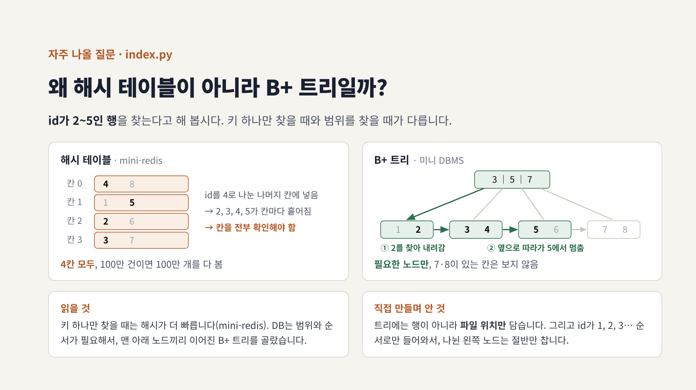

# 미니 DBMS 구현

SQL 문장을 받아 데이터를 파일에 저장하고, 원하는 데이터를 꺼내 주는 작은 데이터베이스(DBMS)를 **SQL 처리기부터 B+ 트리 인덱스, Thread Pool API 서버까지 외부 라이브러리 없이** 직접 만들었습니다.

mini-redis는 키 하나로 값 하나를 꺼내는 캐시라, 요청마다 스레드를 만들고 저장소에 lock 하나만 둬도 충분했습니다. lock 안의 일이 해시 테이블 조회 하나로 아주 짧기 때문입니다.

DBMS는 여러 사람이 열이 있는 같은 데이터를 함께 씁니다. 그래서 먼저 SQL 처리기가 열 이름을 칸 번호로 바꾸고, 쓰기 전에 열과 타입을 확인하고, 전부 해석한 뒤에만 실행해 다시 보내도 중복되지 않게 했습니다.

서버가 요청을 하나씩 받으면 느린 손님 하나가 모두를 멈추기 때문에, 여러 요청을 함께 받도록 스레드 풀을 만들었습니다. 여러 요청을 동시에 처리하자 두 INSERT가 같은 id를 받는 문제가 생겨 lock을 걸었습니다. lock 때문에 실행은 한 줄로 서는데 쿼리가 느리면 줄이 길어져서, 파일 위치를 바로 찾을 수 있는 목차(인덱스)를 만들었습니다. 키 하나만 찾는 해시 테이블과 달리 범위로도 찾을 수 있어서 B+ 트리를 골랐습니다.

```sql
INSERT INTO users (name, age) VALUES ('현지', 25);   -- 저장: users.tbl 파일에 한 줄 추가 (id는 자동으로 1)
SELECT * FROM users WHERE id = 1;                   -- 꺼내기: 파일에서 id가 1인 줄을 찾아 돌려줌 → 1, 현지, 25
```

### 한눈에: 우리가 푼 문제

SQL 한 줄이 서버에 들어와 파일에 닿기까지 지나는 길입니다. 지나는 단계마다 문제를 하나씩 풀었습니다.

```
요청 ─→ [Phase 3] Thread Pool   스레드 4개가 나눠 받음. 대기열까지 차면 503
          ─→ 🔒 lock            엔진에는 한 번에 한 요청만 들어감
             ─→ [Phase 1] SQL 처리기   토큰 → 구문 트리 → 열 이름으로 검사 → 실행
                ─→ [Phase 2] B+ 트리     "id → 파일 위치"로 그 줄만 읽음 (범위 조건도)
                   ─→ 파일 (users.tbl)
```

| Phase | 문제 | 해결 | 숫자로 보면 |
| --- | --- | --- | --- |
| 1. SQL 처리기 | 코드가 열을 **순서**로 읽어서, 열이 하나 끼면 엉뚱한 값을 읽음 | SQL로 열 **이름**을 말하고, 처리기가 스키마로 검사해 스키마 순서로 저장. 문법이 틀린 문장이 섞이면 아무것도 실행 안 함 | `(age, name)` 순서로 넣어도 `[id, name, age]`로 저장 |
| 2. B+ 트리 인덱스 | 데이터가 많으면 처음부터 다 읽어서 느림 | INSERT 때 "id → 파일 위치"를 B+ 트리에 적고, 찾을 때 그 줄만 읽음 | 100만 건에서 id로 찾기 **0.032ms**, 다른 열로 찾기 **1,364ms** |
| 3. Thread Pool | 서버가 요청을 하나씩만 처리해서, 느린 클라이언트 하나가 전체를 멈춤 | 스레드 4개가 대기열(16칸)에서 요청을 꺼내 나눠 처리. 대기열까지 차면 바로 503 | 느린 연결 3개가 붙잡아도 다른 요청은 약 1ms |
| 3. lock | 스레드가 여럿이 되자 동시에 INSERT하면 id가 겹침 | 엔진 입구(`execute`)를 한 번에 한 스레드만 지나가게 함 | 스레드 100개 동시 INSERT: lock 없으면 id가 겹치고, 있으면 1~100 정확 |

**세 가지는 맞물립니다.** Thread Pool이 요청을 동시에 처리하게 만들고, 그래서 생긴 id 겹침을 lock이 막고, lock 안에 머무는 시간은 처리기와 인덱스가 짧게 해 줍니다.

## 실행 및 시연

Python 3.10 이상이면 됩니다. 실행에 필요한 외부 패키지는 없습니다 (테스트에만 pytest).

### 1. 100만 건 성능 비교 (Phase 2)
```bash
python3 bench/run_bench.py 10000 100000    # 빠르게 보기
python3 bench/run_bench.py                 # 1만, 10만, 100만 건 (100만 건은 약 1분, 메모리 약 1.7GB)
```
| 건수 | 넣기 | 켜기(B+ 트리 다시 만들기) | 트리 높이 | id로 찾기 (인덱스) | name으로 찾기 (전체 스캔) | 배 |
|---:|---:|---:|---:|---:|---:|---:|
| 1,000,000 | 48.4초 | 1.87초 | 5 | 0.032ms | 1364.1ms | 43,094배 |

측정 방법과 1만·10만 건 결과는 [phase2](docs/phase2.md)에 있습니다.

### 2. API 서버 (Phase 3)
```bash
python3 server.py                          # http://localhost:8000 (브라우저로 열면 테스트 페이지)
curl -s -X POST localhost:8000/query -d '{"sql": "SELECT * FROM users WHERE id > 1;"}'
curl -s localhost:8000/stats               # 스레드·대기열 상태, 503으로 돌려보낸 수
```

<details>
<summary>동시 요청 · 503 재현 · lock 시연 · CLI · 테스트</summary>

**동시 요청 6개: Thread Pool과 lock**
```bash
for i in 1 2 3 4 5 6; do curl -s -X POST http://localhost:8000/query -d "{\"sql\": \"INSERT INTO users (name, age) VALUES ('u$i', $i);\"}" & done; wait
```
응답의 `id`는 겹치지 않고, 서버 로그에는 `[worker-1]`~`[worker-4]`가 섞여 나옵니다.

**대기열이 차면 503**
```bash
python3 server.py --workers 1 --queue 1    # 터미널 1: 워커 1개, 대기열 1칸
(sleep 3 | nc localhost 8000 &) && (sleep 3 | nc localhost 8000 &) && sleep 0.3 && \
curl -s -X POST http://localhost:8000/query -d '{"sql": "SELECT * FROM users;"}'   # 터미널 2: 세 번째 요청 → 503 busy
```

**lock이 왜 필요한지**
```bash
python3 checks/check_concurrency.py        # lock 끔 → id 중복, lock 켬 → 1~100
```

**CLI (SQL 파일 실행)**
```bash
python3 -m minidb examples/students.sql
python3 -m minidb q.sql --data-dir /tmp/mydb --schema data/schema.json
```
종료 코드: 0 성공, 1 입력 문제(파일 없음, 문법 오류), 2 실행 문제(없는 테이블, 타입 불일치, 손상된 행). 결과는 표준 출력, 오류는 표준 에러.

**테스트**
```bash
pip install -r requirements-dev.txt && pytest   # 313개 (SQL 처리기·B+ 트리·엔진·서버)
python3 checks/check_errors.py                  # 오류 응답 (400·404·405·408·413·500·503)
python3 checks/check_guard.py                   # 엣지 방어 (느린 연결, Content-Length, 끄기)
```

</details>

🎮 [`docs/study/threadpool_simulator.html`](docs/study/threadpool_simulator.html)을 내려받아 브라우저로 열면, 스레드 4개가 대기열에서 요청을 꺼내 가고, lock 앞에서 한 명씩 줄을 서고, 다 차면 503이 나는 모습을 눌러 볼 수 있습니다.

### 왜 실제 Redis처럼 스레드 하나(이벤트 루프)로 하지 않았나요?

| 구분 | 이벤트 루프 (스레드 1개) | 스레드 여러 개 (Thread Pool) |
| --- | --- | --- |
| 잘 맞는 일 | 처리는 아주 짧고 대부분 네트워크를 기다리는 일 (실제 Redis, 채팅 서버) | 처리 하나가 길 수 있는 일 (DB 질의, 파일 읽기) |
| 장점 | 연결이 수만 개여도 스레드 하나라 메모리가 적음. 잠금도 필요 없음 | 클라이언트가 느려도 그 스레드만 붙잡히고, 다른 스레드는 계속 일함[^1] |
| 약점 | 처리 하나가 길면 그동안 모든 연결이 멈춤 | 스레드마다 메모리를 쓰고, 운영체제가 번갈아 돌리는 비용이 듦. 잠금이 필요함 |
| 우리 과제 | 메모리 연산만 짧게 처리할 때 적합 | 미니 DBMS에 채택. 스레드 4개 + 대기열 16칸 (둘 다 기본값)[^1] |

파이썬의 `ThreadPoolExecutor`는 내부 대기열에 끝이 없어서, 요청 1000개를 한꺼번에 보내니 964개가 쌓이고 386개가 시간 초과로 실패했습니다. 직접 만든 Pool은 16칸이 차는 순간 나머지에 503을 보내 1.9초 만에 끝났습니다 ([D34](docs/eungi/DECISIONS.md#step15)).

[^1]: `python3 bench/load_test.py B`. 연결만 열고 1초 동안 본문을 보내지 않는 느린 연결 K개와 빠른 요청 60개를 섞어 보냄. 느린 연결이 스레드 수보다 적으면 빠른 요청은 약 1ms에 답을 받고, 같거나 많으면 모든 스레드가 붙잡혀 약 0.6초를 기다림. 단, 전체 스캔 같은 느린 *쿼리*는 lock 안에서 실행되므로 다른 요청도 기다림. 대기열 16칸은 측정으로 찾은 최적값이 아니라 판단(짧으면 503이 많고, 길면 오래 기다림). 재 보니 4칸과 16칸은 거의 같았음 ([D35](docs/eungi/DECISIONS.md#step15)).

### 왜 기본 스레드는 4개인가요?


- 느린 연결은 스레드 하나를 붙잡습니다. 스레드가 느린 연결보다 **많으면** 남는 스레드가 다른 요청을 받고(0.7ms), **같으면** 모두 붙잡혀 다들 기다립니다(664ms). 그래서 4개 = "느린 연결 3개까지 견딤".
- 더 늘려도 빨라지지 않습니다. SQL 실행은 lock 안에서 한 번에 하나씩이라, 빠른 요청만 있을 때 스레드 1·4·16개가 44·70·68ms로 거의 같았습니다.

연결만 열고 보내지 않는 클라이언트는 5초 뒤 `408`로 끊어 스레드를 오래 붙잡지 못하게 했습니다. 스레드 수와 대기열 칸 수는 `--workers`, `--queue`로 바꿀 수 있습니다.

### 왜 해시 테이블이 아니라 B+ 트리인가요?



- [mini-redis](https://github.com/team1-mini-lab/mini-redis)의 해시 테이블은 키 하나를 찾는 데는 가장 빠르지만 순서를 모릅니다. DB는 `id`가 2~5인 것처럼 범위와 순서가 필요해서, 맨 아래 노드끼리 이어진 B+ 트리를 골랐습니다. `WHERE id > 1`, `id <= 5` 같은 범위 조건도 B+ 트리의 `range_search`로 찾습니다.
- 트리에는 행이 아니라 **파일 위치만** 담습니다. 100만 줄을 메모리에 두 벌 두지 않고, 켤 때 데이터 파일로 다시 만들어 항상 일치시킵니다 (100만 건에 약 1.9초. 서버는 켤 때 미리 만들어 첫 요청이 기다리지 않게 함).
- id가 1, 2, 3… 순서로만 들어와서, 나뉜 왼쪽 노드는 다시 채워지지 않고 절반만 찹니다. 직접 만들어 보고 안 한계입니다.

### 요청이 틀렸을 때 서버는 어디서 무엇이라고 답하나요?


<details>
<summary>글로 보기</summary>

요청은 관문 7개를 차례로 지납니다. 답의 모양은 모두 `{"error": {"code", "message"}}` 하나입니다.

| 관문 | 서버가 묻는 것 | 걸리면 |
| --- | --- | --- |
| ① 들어오기 | 받을 자리가 있나? | 503 `busy` |
| ② 받기 | 5초 안에 다 보냈나? | 408 `timeout` |
| ③ 크기 | 너무 크지 않나? (본문 1MB까지) | 413 `too_large` |
| ④ 형식 | HTTP 모양, Content-Length, JSON이 맞나? | 400 `bad_request` |
| ⑤ 주소·방식 | `POST /query`인가? | 404 / 405 |
| ⑥ SQL | SQL이 맞나? | 400 `bad_sql` + 앞 문장 결과 |
| ⑦ 실행 | 서버가 고장 나지 않았나? (파일 손상 포함) | 500 `internal` (자세한 내용은 로그에만) |

①\~⑥은 클라이언트 쪽 문제, ⑦만 서버 쪽 문제입니다. 받는 쪽 프로그램은 `error.code` 하나만 보고 "다시 보낼지, 보여 줄지, 관리자에게 알릴지"를 정합니다.

</details>

## 지원 SQL

```sql
INSERT INTO students (name, grade) VALUES ('Kim', 3);
INSERT INTO students VALUES ('Lee', 2);          -- 컬럼 생략 시 id 를 뺀 스키마 순서
SELECT * FROM students;
SELECT name, grade FROM students WHERE grade >= 2;
SELECT * FROM users WHERE id > 100;              -- id 범위 조건은 B+ 트리로
```

- 테이블 정의는 `data/schema.json`에 미리 적습니다 (`CREATE TABLE` 없음). 타입은 `INT`, `TEXT`. 첫 컬럼은 반드시 `id INT`이며 값은 자동 부여됩니다.
- 키워드는 대소문자 무관, 식별자는 소문자로 정규화. 문자열은 작은따옴표, 따옴표 자체는 `''`. 문장은 `;`로 끝나며 주석은 `--`.
- `WHERE`는 `컬럼 연산자 값` 하나만. 연산자는 `=` `!=` `<` `<=` `>` `>=`.
- 문법 오류가 하나라도 있으면 아무 문장도 실행하지 않습니다. 실행 오류가 나면 그 문장에서 멈추고, 앞 문장은 되돌리지 않습니다.

## 실제 DBMS와의 차이 (왜 이렇게 만들었나)

| 부분 | 실제 DBMS (MySQL, PostgreSQL) | mini-dbms | 그렇게 한 이유 |
| --- | --- | --- | --- |
| SQL 처리 | 토큰 → 구문 트리 → 실행 계획을 비교해 가장 빠른 방법 선택 | 토큰 → 구문 트리 → 바로 실행. id 조건이면 인덱스, 아니면 전체 스캔 | 테이블 하나를 조회하는 문장이라, 옵티마이저 없이도 SQL 처리 원리를 구현하기에 충분함 |
| 저장 방식 | 8\~16KB 페이지 단위. 자주 쓰는 페이지는 메모리에 캐시(버퍼 풀) | 한 줄에 한 행, 값은 탭으로 나눠 파일 끝에 붙임 | 파일을 눈으로 바로 확인할 수 있고, 값에 쉼표나 한글이 들어가도 깨지지 않음 |
| 인덱스 | B+ 트리를 디스크 페이지에 저장. 켤 때 다시 만들지 않음 | B+ 트리가 메모리에만 있음. 켤 때 파일을 읽어 다시 만듦 | 데이터 파일을 기준으로 다시 만들면 비정상 종료 뒤에도 항상 일치함 |
| 동시성 | 행 단위 잠금 + 읽는 쪽이 옛 버전을 보는 방식(MVCC) | 엔진 lock 하나[^2] | 기존 행을 고치지 않아 경합 지점이 다음 번호·파일 끝·인덱스뿐. 교착 상태가 없음. 대신 느린 쿼리는 다른 요청을 기다리게 함 |
| 트랜잭션·복구 | 여러 문장을 "모두 되거나 모두 안 되게" 묶음. 쓰기 전에 로그를 남겨(WAL) 꺼져도 복구 | 없음. 문장마다 바로 저장. 쓰다 만 마지막 줄만 켤 때 잘라 냄 | 과제 핵심(파서·인덱스·서버)에 집중. 대신 실행 중 오류면 앞 문장까지의 결과를 돌려줘 중복 재시도를 막음 |
| 연결 처리 | 자체 통신 방식 + 스레드 풀이나 프로세스 | HTTP + JSON + 직접 만든 Thread Pool | 브라우저·`curl`로 별도 드라이버 없이 테스트할 수 있고, 대기열 상한으로 503 과부하 방어를 직접 제어함 |
| 오류 | 표준 오류 코드(SQLSTATE) | 정해 둔 JSON 코드 `bad_sql`, `busy` 등 | `error.code` 하나로 원인을 구분하고, SQL 실수(400)와 서버 장애(500)를 나눠 내부 경로가 밖으로 나가지 않게 함 |

[^2]: 실제 DB의 행 단위 잠금은 기존 행을 고칠 때 그 행만 잠그는 방식입니다. 우리는 `UPDATE`·`DELETE`가 없어 고칠 행이 없고, INSERT끼리 다투는 건 테이블에 하나뿐인 다음 번호·파일 끝·B+ 트리입니다. SELECT끼리는 동시에 하게(읽기·쓰기 lock) 풀면 빨라질지도 재 봤는데, 1만 줄 전체 스캔 16개를 스레드 4개로 돌리니 209ms → 1,700ms로 오히려 느려졌습니다. 파이썬은 GIL 때문에 한 번에 한 스레드만 코드를 실행해서, 차례를 바꾸는 비용만 늘었습니다 ([STEP16](docs/eungi/STEP16.md)).

## 한계

- 같은 데이터 폴더에 한 번에 한 프로세스만 쓴다고 가정합니다. 서버는 lock으로 요청을 줄 세우지만, 서버가 켜진 채로 같은 폴더에 CLI로 쓰는 것은 막지 못합니다.
- 범위가 넓으면(`id > 0`) 줄마다 위치로 읽어서 전체 스캔보다 느릴 수 있습니다. 비용을 따져 경로를 고르는 기능은 없습니다.
- 100만 건을 CLI로 넣을 때 메모리를 약 1.7GB 씁니다 (파일 전체를 먼저 해석하는 구조).
- `CREATE TABLE`, `UPDATE`, `DELETE`, NULL, `AND`/`OR`, `ORDER BY`, `LIMIT`, JOIN, 트랜잭션, WAL은 지원하지 않습니다.

## 문서

| 문서 | 이럴 때 읽기 |
| --- | --- |
| [왜 DBMS인가](docs/study/WHY_DBMS/WHY_DBMS.md) | DBMS가 어떤 문제를 풀려고 나왔는지 폴더 하나 예시로 보고 싶을 때. **처음이면 여기부터** |
| [전체 그림](docs/study/OVERVIEW.md) | SQL 한 줄이 파일에 저장되고 다시 꺼내지기까지를 코드로 따라가고 싶을 때 |
| [설계](docs/DESIGN.md) | 단계별로 무엇을 만들고, 언제 완료인지 볼 때 |
| [Phase 1 단계 문서](docs/steps/) | 토크나이저부터 엣지 케이스까지, SQL 처리기의 단계별 설계와 결정 |
| [Phase 2](docs/phase2.md) | B+ 트리를 실행기에 붙인 방법, 범위 검색, 100만 건 성능 비교 |
| [Phase 3](docs/eungi/) | Thread Pool([STEP15](docs/eungi/STEP15.md)), lock([STEP16](docs/eungi/STEP16.md)), 오류 응답([STEP17](docs/eungi/STEP17.md)) |
| [결정 기록](docs/eungi/DECISIONS.md) | "왜 이렇게 만들었나"를 결정 번호로. Phase 1(H1\~H12), Phase 2(S1\~S7), Phase 3(D30\~D48) |
| [학습 노트](docs/study/DBMS_study.md) | "왜 이렇게 만드나"를 설명할 수 있는지 스스로 확인할 때 |
| [과제 요구사항](docs/REQUIREMENTS.md) | 과제 원문 |
