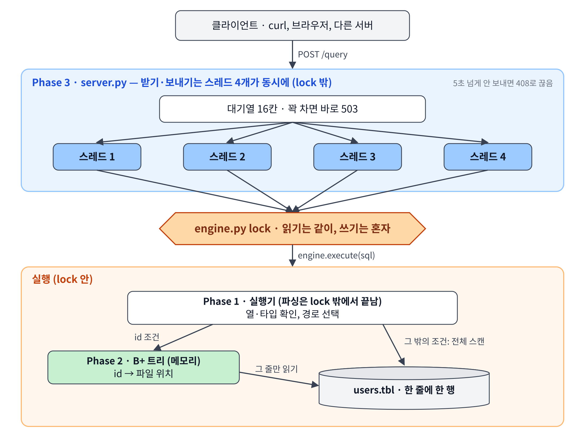
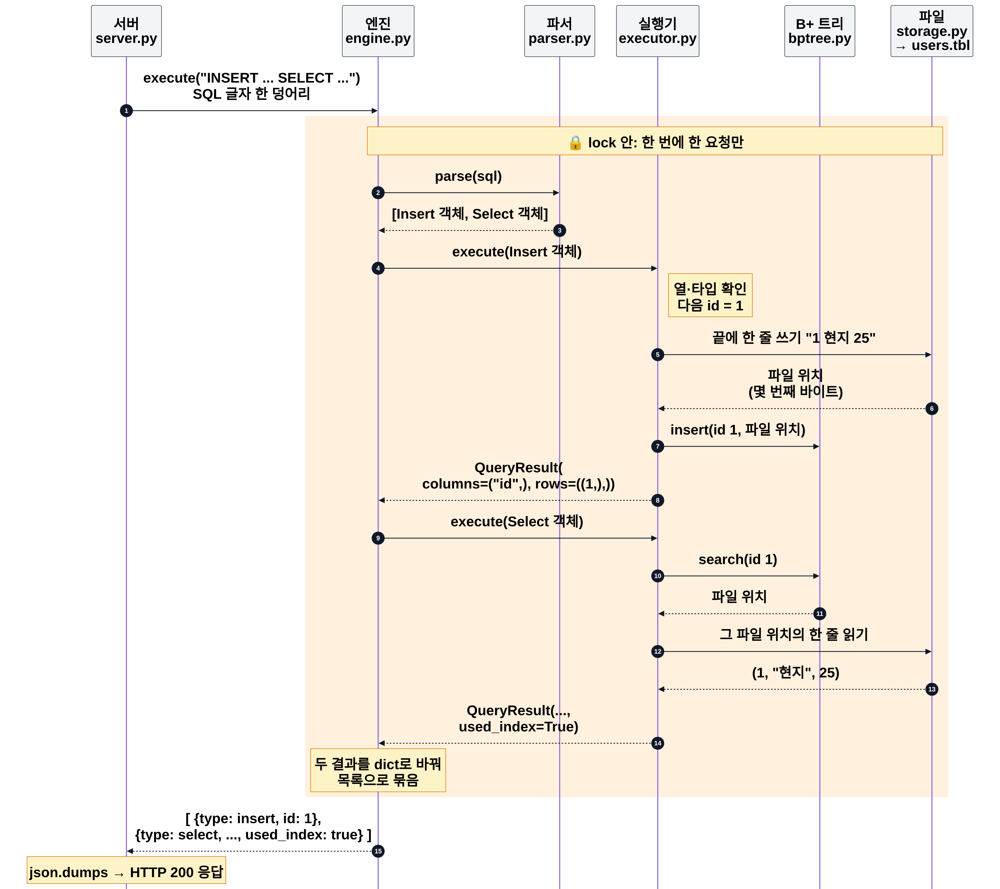
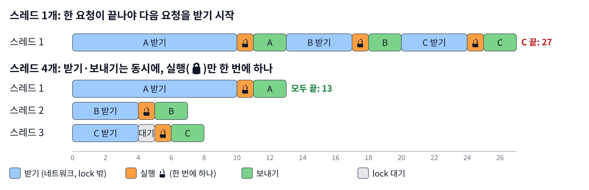

# 미니 DBMS 구현

SQL 문장을 받아 데이터를 파일에 저장하고, 원하는 데이터를 꺼내 주는 작은 데이터베이스(DBMS)를 **SQL 처리기부터 B+ 트리 인덱스, Thread Pool API 서버까지 외부 라이브러리 없이** 직접 만들었습니다.

```sql
INSERT INTO users (name, age) VALUES ('현지', 25);   -- 저장: users.tbl 파일에 한 줄 추가 (id는 자동으로 1)
SELECT * FROM users WHERE id = 1;                   -- 꺼내기: B+ 트리로 위치를 찾아 그 한 줄만 읽음 → 1, 현지, 25
```

[mini-redis](https://github.com/team1-mini-lab/mini-redis)는 키 하나로 값 하나를 꺼내는 메모리 캐시였습니다. DBMS는 꺼져도 데이터가 남게 파일에 쓰고, 키 하나가 아니라 열과 범위로도 찾고, 여러 사람이 동시에 씁니다. 그래서 세 가지 문제를 풀었습니다.

**1. 데이터의 모양 (Phase 1).** 어떤 열이 몇 번째 칸에 있는지를 여러 코드가 각자 알고 있으면, 열 하나가 추가되거나 바뀔 때 그 파일을 읽는 코드를 전부 고쳐야 합니다. 그래서 파일의 모양은 SQL 처리기 한 곳만 알게 했습니다. 다른 코드는 열 이름으로 요청하고, 열 이름을 칸 번호로 바꾸는 일, 그리고 잘못된 값(없는 열, 숫자 칸에 글자)이 파일에 들어가기 전에 막는 일은 처리기가 맡습니다. [→ 코드로 보기](#phase-1-파일-모양은-왜-sql-처리기-한-곳만-아나요)

**2. 많은 행 (Phase 2).** 목차가 없으면 100만 건을 처음부터 훑습니다(1,364ms). INSERT 때 자동으로 붙는 id와 그 줄의 파일 위치를 메모리의 목차(B+ 트리)에 적어 두고, 찾을 때 그 줄만 읽습니다(0.032ms). DB는 `id > 990000`처럼 범위를 묻는데, 해시 테이블은 키를 칸마다 흩어 두어 범위를 찾으려면 전부 봐야 합니다. 그래서 키를 정렬해 이웃끼리 이어 두는 B+ 트리를 골랐습니다(범위 1,000줄을 찾는 데 전체 스캔보다 342배 빠름). [→ 왜 B+ 트리인가](#phase-2-왜-해시-테이블이-아니라-b-트리인가요)

**3. 동시에 오는 요청 (Phase 3).**
- **스레드 4개가 병렬로 처리합니다** → 요청 받기와 응답 보내기는 스레드 4개가 동시에 합니다. 그래서 접속만 하고 요청을 다 보내지 않는 느린 연결 하나에 모두가 막히지 않습니다.
- **파일을 읽기만 하는 명령은 같이, 파일에 쓰는 명령은 혼자** → SELECT는 파일과 목차를 읽기만 해서 여럿이 동시에 실행해도 서로 망가뜨리지 않습니다. INSERT는 파일 끝에 쓰면서 다음 id와 목차도 바꾸기 때문에, 중간에 다른 명령이 끼지 않게 혼자 실행합니다. 덕분에 오래 걸리는 SELECT가 도는 중에도 짧은 SELECT는 기다리지 않고 바로 답을 받습니다.
- **그래서 스레드 수를 정했습니다** → 파이썬은 GIL[^gil] 때문에 한순간에 한 스레드만 코드를 돌려서 스레드를 늘려도 총 처리 속도는 늘지 않고, INSERT나 긴 쿼리가 오면 그동안 요청이 쌓입니다. mini-redis는 처리가 키 조회 정도로 짧아 요청마다 스레드를 만들어도 금방 끝났지만, DBMS는 실행이 길 수 있어 스레드 4개와 대기열 16칸까지만 받고 넘치면 바로 503으로 돌려보냅니다.

[→ lock은 어디에](#phase-3-서버엔진실행기를-어떻게-나누고-lock은-어디에-두었나요) · [→ 스레드 수는 왜](#phase-3-스레드는-왜-여럿이고-왜-4개와-16칸인가요)



## 실행 및 시연

Python 3.10 이상이면 됩니다(구현·측정은 Python 3.13). 실행에 필요한 외부 패키지는 없으며 `threading`·`queue`·`http.server`·`os.pread` 같은 표준 라이브러리만 썼습니다(테스트에만 `pytest`).

### 1. SQL 처리기: SQL 파일을 CLI로 (Phase 1)
```bash
python3 -m minidb examples/step1.sql --data-dir /tmp/demo --schema data/schema.json
python3 -m minidb examples/step2.sql --data-dir /tmp/demo --schema data/schema.json
```
- 첫째 줄: INSERT 2개 + SELECT
- 둘째 줄: 다시 실행해 id = 2 조회

```
1 row inserted (id=1)
1 row inserted (id=2)
id | name | age
---+------+----
1  | 현지 | 25
2  | 민수 | 31
```
데이터는 `/tmp/demo/users.tbl`에 한 줄씩 저장되어, 프로그램을 다시 실행해도 남아 있고 id로 바로 찾습니다. 종료 코드는 0 성공, 1 입력 문제(파일 없음, 문법 오류), 2 실행 문제(없는 테이블, 타입 불일치)입니다. 같은 SQL 처리기를 3번의 API 서버도 그대로 씁니다(`curl`로 SQL을 보내면 같은 결과가 JSON으로 옴).

### 2. 100만 건 성능 비교 (Phase 2)
```bash
python3 bench/run_bench.py 10000 100000
python3 bench/run_bench.py
```
- 첫째 줄: 빠르게 보기
- 둘째 줄: 1만, 10만, 100만 건 (100만 건은 약 1분, 메모리 약 1.7GB)

| 건수 | 넣기 | 켜기(B+ 트리 다시 만들기) | 트리 높이 | id로 찾기 (인덱스) | name으로 찾기 (전체 스캔) | 배 |
|---:|---:|---:|---:|---:|---:|---:|
| 1,000,000 | 48.4초 | 1.87초 | 5 | 0.032ms | 1364.1ms | 43,094배 |

범위로 찾을 때(`WHERE id > 999000`, 마지막 1,000줄)는 B+ 트리가 6.36ms, 같은 조건의 전체 스캔이 2,176ms로 342배 빠릅니다. 시작 id 하나를 찾은 뒤 이웃끼리 이어진 잎을 따라 1,000줄만 읽기 때문입니다. (같은 맥북, 다른 날 측정)

INSERT 100만 줄을 만들어 CLI로 넣고, 같은 데이터에서 두 경로의 시간을 잽니다([측정 방법](docs/phase2.md)).

### 3. API 서버와 동시성 (Phase 3)
```bash
python3 server.py
curl -s -X POST localhost:8000/query -d '{"sql": "SELECT * FROM users WHERE id > 1;"}'
curl -s localhost:8000/stats
```
- 첫째 줄: http://localhost:8000 (브라우저로 열면 테스트 페이지)
- 셋째 줄: 스레드·대기열 상태, 503으로 돌려보낸 수


**lock이 없을 때와 있을 때.** 스레드 100개가 동시에 INSERT합니다. lock을 끄면 여러 행이 같은 id를 받고, 켜면 1~100이 정확히 나옵니다.
```bash
python3 checks/check_concurrency.py
```

**읽는 명령은 기다리지 않고, 쓰는 명령은 기다리나요?** 100만 건 전체 스캔처럼 오래 걸리는 SELECT를 돌려 두고, 그 사이에 짧은 SELECT와 INSERT를 하나씩 보내 봅니다. 짧은 SELECT는 같이 들어가 곧바로 답이 오고, INSERT는 긴 SELECT가 끝난 뒤에야 답이 옵니다.
```bash
python3 checks/check_rw.py
```

**느린 연결이 있어도 다른 요청은 바로 답을 받나요?** 서버에 접속만 하고 아무것도 보내지 않는 클라이언트(`nc`)를 하나 만든 뒤, 바로 조회를 보냅니다.
- 스레드 1개(`python3 server.py --workers 1`): 하나뿐인 스레드가 그 클라이언트를 기다리느라, 조회는 약 4.7초 뒤에 답을 받습니다. 감시 스레드가 5초 동안 요청을 다 보내지 않은 연결을 408로 끊은 뒤에야 차례가 옵니다.
- 스레드 4개(기본값): 남은 스레드가 조회를 받아 바로 답합니다.
```bash
(sleep 3 | nc localhost 8000 &) ; sleep 0.3
time curl -s -X POST localhost:8000/query -d '{"sql": "SELECT * FROM users WHERE id = 1;"}'
```

**요청이 몰릴 때.** INSERT는 혼자 실행되고 GIL 때문에 SELECT도 총 속도가 늘지 않아, 요청이 몰리면 줄이 생깁니다. 그 줄은 스레드 수와 대기열 칸 수로 제어해서, 다 차면 기다리게 하지 않고 바로 503으로 돌려보냅니다. 재현 방법은 [품질](#품질-테스트와-엣지-케이스)에 있습니다.

## 설계: 왜 이렇게 만들었나

### Phase 1: 파일 모양은 왜 SQL 처리기 한 곳만 아나요?

어떤 열이 몇 번째 칸에 있는지를 여러 코드가 각자 알고 있으면, 열 하나가 바뀔 때 그 파일을 읽는 코드를 전부 고쳐야 합니다([왜 DBMS인가](docs/study/WHY_DBMS/WHY_DBMS.md)의 문제 1). 그래서 모양은 **한 파일**에만 적고, 그걸 읽는 건 **SQL 처리기**뿐입니다.

**① 모양은 `data/schema.json` 한 곳에만 있습니다.**
```json
"users": {"columns": [{"name": "id", "type": "INT"}, {"name": "name", "type": "TEXT"}, {"name": "age", "type": "INT"}]}
```

**② INSERT: 사용자가 쓴 순서를 스키마 순서로 바꿉니다** (`minidb/executor.py`)
```python
given = dict(zip(columns, stmt.values))          # {name: '지수', age: 30}  ← 사용자가 쓴 순서
...
return tuple(given[c] for c in table.user_columns)  # ('지수', 30)          ← 스키마 순서
```
```sql
INSERT INTO users (age, name) VALUES (30, '지수');   -- users.tbl에는 "1	지수	30"으로 저장
```

**③ SELECT: 열 이름을 칸 번호로 바꿔 꺼냅니다** (`minidb/executor.py`, `minidb/catalog.py`)
```python
out_indexes = [table.column_index(n) for n in out_names]   # ["age", "name"] → [2, 1]
rows = [tuple(row[i] for i in out_indexes) for row in candidates if predicate(row)]
```

서버와 엔진은 칸 번호를 모르고 SQL과 열 이름만 주고받습니다. 그래서 열 순서가 바뀌어도 `schema.json`과 처리기만 고치면 됩니다. 열 이름·빠진 열·타입(INT·TEXT) 확인도 처리기 한 곳에서 해서, `age`에 `'스물'`은 파일에 들어가기 전에 막힙니다.

단, `INSERT INTO users VALUES ('지수', 30)`처럼 열 이름을 빼면 스키마 순서대로 받습니다.

### Phase 2: 왜 해시 테이블이 아니라 B+ 트리인가요?

DB에 오는 질문은 `id = 7`처럼 하나만 찾는 것보다, "최근 주문 1만 건"(`id > 990000`)처럼 **이보다 크거나 작은 것을 찾는 범위**가 많습니다. 범위를 찾으려면 "2 다음은 3"이라는 순서, 즉 이웃을 알아야 합니다.

```
해시 테이블   칸0 [4, 8]   칸1 [1, 5]   칸2 [2, 6]   칸3 [3, 7]
              → 2~5가 칸마다 흩어져 있어, 칸을 전부 봐야 함

B+ 트리 잎    [1, 2] → [3, 4] → [5, 6] → [7, 8]
              → 2를 찾아 내려간 뒤 오른쪽으로 따라가다, 5를 넘으면 멈춤
```

해시 테이블은 키 하나를 찾는 데는 가장 빠르지만(mini-redis), 키를 계산식으로 흩어 두어 이웃을 모릅니다. B+ 트리는 키를 정렬해 두고 맨 아래 노드(잎)끼리 `next_leaf`로 이어 두어서, 시작점만 찾으면 옆으로 따라가면 됩니다 (`minidb/bptree.py`).
```python
leaf = self._find_leaf(start)          # 시작값이 있을 잎까지 한 번만 내려감
i = bisect_left(leaf.keys, start)      # 잎 안에서 시작 위치
while leaf is not None:
    while i < len(leaf.keys):
        if leaf.keys[i] > end:         # 끝값을 넘으면 멈춤
            return result
        result.append((leaf.keys[i], leaf.values[i]))
        i += 1
    leaf = leaf.next_leaf              # 옆 잎으로 이동
    i = 0
```

실행기는 `WHERE id > 1`을 `range_search(2, ∞)`로 바꿔 부르고, 결과에 `used_index: true`를 붙입니다. id가 아닌 열(`name`, `age`)은 목차가 없어 전체 스캔합니다.

- **메모리에 위치만:** 트리에는 행이 아니라 파일 위치만 담고, 켤 때 데이터 파일로 다시 만들어 항상 일치시킵니다(100만 건에 약 1.9초, 서버는 켤 때 미리 만듦).
- **직접 만들어 보고 안 한계:** id가 순서대로만 들어와서, 나뉜 왼쪽 노드는 다시 채워지지 않고 절반만 찹니다.

### Phase 3: 서버·엔진·실행기를 어떻게 나누고, lock은 어디에 두었나요?

가장 오래 고민한 부분입니다. 서버(네트워크)와 SQL 처리기(데이터)는 하는 일이 달라서 나눴고, 나누자 "둘을 무엇으로 이을까, lock은 어디에 둘까"를 정해야 했습니다.

- **서버와 엔진을 나눔.** 서버는 네트워크만, 엔진은 SQL만 압니다. 같은 처리기를 CLI와 서버가 함께 쓰고, 따로 테스트하고, 한쪽을 바꿔도 다른 쪽은 그대로입니다.
- **잇는 곳은 `engine.execute(sql)` 하나.** 엔진이 결과를 dict 목록으로 돌려주고, 서버는 그걸 JSON으로만 바꿉니다.
- **엔진은 전부 파싱한 뒤 실행기에 하나씩.** SQL을 문장 객체(AST)로 만든 뒤 넘겨서, 문법이 틀린 문장이 섞이면 하나도 실행하지 않습니다. 파싱은 공유 자료를 건드리지 않아 lock 밖에서 합니다.
  ```
  "INSERT INTO users (name, age) VALUES ('현지', 25); SELECT * FROM users WHERE id = 1;"
      ↓ parse(sql): 문장 하나 → 객체 하나
  [ Insert(table="users", columns=("name", "age"), values=("현지", 25)),
    Select(table="users", columns=None, where=Condition("id", "=", 1)) ]
  ```
  엔진은 이 목록을 보고 lock을 고른 뒤(전부 `Select`면 읽기, `Insert`가 있으면 쓰기), 객체를 하나씩 실행기에 넘깁니다.
- **실행기는 문장 하나만.** 열·타입 확인, B+ 트리 또는 전체 스캔, 파일 읽고 쓰기. Phase 1·2 코드를 그대로 씁니다.
- **lock은 엔진 입구 한 곳, 읽기·쓰기로 나눔.** 요청 하나(문장 여러 개)를 통째로 묶습니다. SQL이 전부 SELECT면 읽기 lock(여럿이 같이), INSERT가 하나라도 있으면 쓰기 lock(혼자)을 잡습니다. 스레드가 없는 CLI에는 붙지 않습니다.



**파일을 읽기만 하는 명령은 같이, 파일에 쓰는 명령은 혼자 들어갑니다.**


- **읽기만 하는 명령(SELECT)은 같이 (A, B):** 파일과 B+ 트리를 읽기만 해서 서로 영향이 없습니다. 파일은 `os.pread`로 읽을 위치를 매번 넘겨 읽어서 동시에 읽어도 섞이지 않습니다.
- **파일에 쓰는 명령(INSERT)은 혼자 (C):** 파일 끝에 쓰면서 다음 id를 올리고 B+ 트리도 바꿉니다. 그래서 안에서 읽던 명령이 다 나간 뒤 혼자 들어갑니다.
- **쓰는 명령이 기다리면 그 뒤에 (D):** 읽는 명령이 계속 몰려도 쓰는 명령이 영영 못 들어가는 일이 없게, 새로 온 읽는 명령은 기다리는 쓰는 명령 뒤에 섭니다.

나중에 명령을 더해도 같은 기준입니다. UPDATE·DELETE는 파일에 쓰니까 혼자, ORDER BY·COUNT는 읽기만 하니까 같이 들어갑니다.

### Phase 3: 스레드는 왜 여럿이고, 왜 4개와 16칸인가요?

요청 하나는 세 단계를 거칩니다.

1. **받기:** 클라이언트가 보낸 SQL이 네트워크로 도착하기를 기다립니다.
2. **실행:** SQL 처리기가 다음 id, 파일, B+ 트리를 읽거나 씁니다.
3. **보내기:** 결과를 JSON으로 돌려줍니다.

**받기와 보내기는 공유 자료를 건드리지 않아서 스레드 4개가 동시에 합니다.** 한 스레드가 느린 손님의 요청을 기다리거나 응답을 보내는 동안, 다른 스레드는 다음 손님을 받고 실행으로 넘깁니다. **실행은 공유 자료를 만지므로 엔진 입구의 lock을 거칩니다.** 읽는 명령(SELECT)끼리는 같이, 쓰는 명령(INSERT)은 혼자 들어갑니다(위 그림). 다만 파이썬은 GIL 때문에 같이 들어간 SELECT들도 한순간에 하나씩 번갈아 돌아서, 총 처리 속도는 늘지 않습니다.


<sub>시간은 설명용 단위입니다. 실제 측정은 아래 숫자를 보세요.</sub>

- **왜 여럿인가:** 스레드가 1개뿐이면 느린 연결 1개만 들어와도 다른 모든 요청이 멈춥니다. 여러 스레드를 두면 한 스레드가 네트워크를 기다리는 동안 다른 스레드가 요청을 받아 처리할 수 있습니다(느린 연결이 스레드를 다 채우기 전까지는 다른 요청이 0.7ms에 답을 받음). 다만 느린 연결은 얼마든지 많이 올 수 있어 스레드 수로 버티는 데는 한계가 있으므로, 5초 넘게 요청을 다 보내지 않는 연결은 감시 스레드가 408로 끊어 방어합니다.
- **왜 4개이고 무한정 늘리지 않나:** 스레드를 코어 수보다 많이 늘려도 동시에 계산할 수 있는 건 코어 수만큼뿐이고, 서로 번갈아 실행하는 비용과 메모리만 늘어납니다. 특히 파이썬은 네트워크를 기다리는 일은 여러 스레드가 겹쳐서 할 수 있지만, 실제 파이썬 코드를 실행해 계산하는 일은 한 번에 한 스레드씩 번갈아 돌아야 합니다(GIL). 그래서 부하 테스트(python3 bench/load_test.py)에서도 실행이 짧은 id 조회는 네트워크 대기가 겹쳐 빨라지지만, 1만 줄을 훑는 name 전체 스캔처럼 계산이 긴 요청은 스레드를 늘려도 거의 빨라지지 않았고, 빠른 요청도 1·4·16개일 때 걸린 시간이 같았습니다(STEP15 ["왜 기본 스레드가 4개인가요?"](docs/eungi/STEP15.md#발표-때-나올-질문))[^switch].
- **왜 대기열 16칸 + 503인가:** 대기열은 짧으면 순간 몰림 때 503 거절률이 높아지고, 길면 대기시간이 길어져 타임아웃으로 실패합니다. 실제로 제한 없이 쌓았을 때는 1,000개 중 386개가 실패했고([D34](docs/eungi/DECISIONS.md#step15)), python3 bench/load_test.py에서도 큐 크기(1·4·16·64칸)에 따른 200 성공 수, 503 거절 수, 최대 대기시간을 비교해 16칸으로 정했습니다.
- **왜 ThreadPoolExecutor 대신 직접 만들었나:** 표준 라이브러리의 ThreadPoolExecutor는 대기열 칸 수를 제한할 수 없어, 넘치는 요청을 바로 503으로 돌려보내기 어렵습니다. 그래서 threading과 queue.Queue(maxsize=16)으로 Thread Pool을, Lock·Condition으로 읽기·쓰기 lock을 직접 구현했습니다.
- **느린 쿼리는:** 스레드가 아니라 B+ 트리가 줄입니다(id 조건 0.032ms).
- **왜 Redis처럼 스레드 하나(이벤트 루프)가 아닌가:** 이벤트 루프는 요청이 다 도착한 연결부터 처리해 짧은 요청에서는 높은 처리량(req/s)을 내지만, 1초 넘는 전체 스캔 같은 작업이 하나만 들어와도 끝날 때까지 전체가 멈춰 다른 요청의 처리량이 0이 됩니다. 반면 Thread Pool(스레드 4개) + 읽기·쓰기 lock에서는 긴 스캔이 도는 중에도 다른 스레드가 짧은 조회를 바로 처리할 수 있어 스레드 풀을 골랐습니다([자세히](docs/dbms-differences.md#왜-이벤트-루프가-아닌가)).

측정은 `python3 bench/load_test.py`, 설정은 `--workers`, `--queue`로 바꿉니다. [`docs/study/threadpool_simulator.html`](docs/study/threadpool_simulator.html)을 내려받아 열면 이 과정을 눌러 볼 수 있습니다.

## 품질: 테스트와 엣지 케이스

```bash
pip install -r requirements-dev.txt && pytest
python3 checks/check_all.py
python3 checks/check_threadpool.py
python3 checks/check_errors.py
python3 checks/check_guard.py
```
- 첫째 줄: 단위 테스트 357개 (SQL 처리기·B+ 트리·엔진·서버·병렬 실행)
- 둘째 줄: 기능 테스트 (INSERT·SELECT·인덱스 사용·열 순서·재시작 뒤 id 이어짐)
- 셋째 줄: Thread Pool (여러 스레드가 나눠 받기, 대기열 포화 시 503)
- 넷째 줄: 오류 응답 (400·404·405·408·413·500·503)
- 다섯째 줄: 엣지 방어 (느린 연결, Content-Length, 끄기)


### 요청이 틀리면 어디서 무엇이라고 답하나요?

요청은 관문 7개를 차례로 지납니다. 답의 모양은 모두 `{"error": {"code", "message"}}` 하나입니다.

| 관문 | 서버가 묻는 것 | 걸리면 |
| --- | --- | --- |
| ① 들어오기 | 받을 자리가 있나? | 503 `busy` |
| ② 받기 | 5초 안에 다 보냈나? | 408 `timeout` |
| ③ 크기 | 너무 크지 않나? (본문 1MB까지) | 413 `too_large` |
| ④ 형식 | HTTP 모양, Content-Length, JSON이 맞나? | 400 `bad_request` |
| ⑤ 주소·방식 | `POST /query`인가? | 404 / 405 |
| ⑥ SQL | SQL이 맞나? | 400 `bad_sql` + 앞 문장 결과 |
| ⑦ 실행 | 서버가 고장 나지 않았나? (파일 손상 포함) | 500 `internal` (자세한 내용은 로그에만) |

①\~⑥은 클라이언트 쪽 문제, ⑦만 서버 쪽 문제입니다. 받는 쪽 프로그램은 `error.code` 하나만 보고 "다시 보낼지, 보여 줄지, 관리자에게 알릴지"를 정합니다.


예를 들어 스레드와 대기열을 모두 채우면 세 번째 요청은 바로 503을 받습니다.
```bash
python3 server.py --workers 1 --queue 1
(sleep 3 | nc localhost 8000 &) && (sleep 3 | nc localhost 8000 &) && sleep 0.3 && \
curl -s -X POST http://localhost:8000/query -d '{"sql": "SELECT * FROM users;"}'
```
- 첫째 줄(터미널 1): 스레드 1개, 대기열 1칸으로 켜기
- 둘째·셋째 줄(터미널 2): 느린 연결 2개로 자리를 채운 뒤 세 번째 요청 → 바로 503


## 참고

### 쓸 수 있는 SQL 문법

<details>
<summary>INSERT · SELECT · WHERE 문법과 규칙</summary>

```sql
INSERT INTO students (name, grade) VALUES ('Kim', 3);
INSERT INTO students VALUES ('Lee', 2);          -- 컬럼 생략 시 id 를 뺀 스키마 순서
SELECT * FROM students;
SELECT name, grade FROM students WHERE grade >= 2;
SELECT * FROM users WHERE id > 100;              -- id 범위 조건은 B+ 트리로
```

- 테이블 정의는 `data/schema.json`에 미리 적습니다 (`CREATE TABLE` 없음). 타입은 `INT`, `TEXT`. 첫 컬럼은 반드시 `id INT`이며 값은 자동 부여됩니다.
- 키워드는 대소문자 무관, 식별자는 소문자로 정규화. 문자열은 작은따옴표, 따옴표 자체는 `''`. 문장은 `;`로 끝나며 주석은 `--`.
- `WHERE`는 `컬럼 연산자 값` 하나만. 연산자는 `=` `!=` `<` `<=` `>` `>=`.
- 문법 오류가 하나라도 있으면 아무 문장도 실행하지 않습니다. 실행 오류가 나면 그 문장에서 멈추고, 앞 문장은 되돌리지 않습니다.

</details>

### 실제 DBMS와의 차이

MySQL·PostgreSQL과 무엇이 다르고 왜 이렇게 만들었는지는 [실제 DBMS와 다른 점](docs/dbms-differences.md)에 항목별로 정리했습니다. 동시성(행 단위 잠금 대신 읽기·쓰기 lock), 인덱스(메모리에만, `id` 하나), 트랜잭션(없음) 등을 다룹니다.

### 한계

| 한계&nbsp;&nbsp;&nbsp;&nbsp;&nbsp;&nbsp;&nbsp;&nbsp;&nbsp;&nbsp;&nbsp;&nbsp;&nbsp;&nbsp;&nbsp;&nbsp;&nbsp;&nbsp;&nbsp;&nbsp;&nbsp;&nbsp; | 무슨 일이 생기나&nbsp;&nbsp;&nbsp;&nbsp;&nbsp;&nbsp;&nbsp;&nbsp;&nbsp;&nbsp;&nbsp;&nbsp;&nbsp;&nbsp;&nbsp;&nbsp;&nbsp;&nbsp;&nbsp;&nbsp;&nbsp;&nbsp;&nbsp;&nbsp;&nbsp;&nbsp;&nbsp;&nbsp;&nbsp;&nbsp; | 이렇게 둔 이유 | 고치려면&nbsp;&nbsp;&nbsp;&nbsp;&nbsp;&nbsp;&nbsp;&nbsp;&nbsp;&nbsp; |
|---|---|---|---|
| 목차(인덱스)는&nbsp;`id`에만 | `WHERE name = '현지'`처럼 목차가 없는 열로 찾으면 100만 줄을 다 읽음(1,364ms). 그동안 INSERT는 기다림 (SELECT끼리는 같이 실행) | 목차는 하나 늘 때마다 INSERT가 고칠 곳이 하나 늘어 쓰기가 느려지고 메모리도 듭니다. 이름·나이는 같은 값이 여러 줄이라 "값 → 위치 여러 개"를 담는 구조도 따로 필요합니다. 그래서 요구사항의 검색 조건인 id에 먼저 만들고, 쓰기 비용을 늘리는 다른 열의 목차는 필요가 확인될 때 더하기로 했습니다. | 자주 찾는 열에 보조 인덱스 추가 |
| 열을&nbsp;추가할&nbsp;수&nbsp;없음 | `schema.json`에 `email` 열을 더하면, 이미 저장된 줄은 값이 3개라 "손상된 행" 오류 | 줄마다 칸 이름 없이 스키마 순서대로 값만 적어서 파일이 작고 읽기가 단순합니다. 대신 표 모양이 바뀌면 옛 줄을 해석할 정보가 없습니다. 요구사항이 표가 이미 있다고 가정하고 있어서, 표 모양 변경보다 이 단순함을 택했습니다. | 옛 줄에 기본값을 채우는 `ALTER TABLE` |
| 한&nbsp;폴더는&nbsp;프로그램&nbsp;하나만 | 서버가 켜진 채로 다른 터미널에서 같은 폴더에 CLI로 INSERT하면, 서버가 같은 id를 또 줄 수 있음 | lock은 서버 프로그램 메모리 안의 변수라, 같은 서버의 스레드끼리만 막고 따로 실행한 CLI는 볼 수 없습니다. 서버를 켜 두면 서버만 파일에 쓰는 것으로 정했습니다. | 파일 자체에 운영체제 잠금(파일 lock) |
| 넓은&nbsp;범위는&nbsp;느릴&nbsp;수&nbsp;있음 | `id > 0`처럼 거의 모든 줄이 해당하면, 목차로 하나씩 찾아 읽는 게 쭉 읽는 것보다 느림 | 해당하는 줄 수를 어림하려면 열마다 통계를 따로 관리해야 합니다. `=`나 좁은 범위에서는 목차가 수백~수만 배 빨라서, 통계 없이 id 조건이면 목차를 쓰는 쪽을 택했습니다. | 줄 수를 어림해 빠른 쪽을 고르는 옵티마이저 |
| 같이&nbsp;실행해도&nbsp;속도는&nbsp;그대로 | SELECT 여러 개가 같이 들어가도, 다 끝나는 시간은 하나씩 할 때와 비슷함 | 파이썬은 GIL 때문에 한순간에 한 스레드만 코드를 실행합니다. 대신 짧은 SELECT가 긴 SELECT 뒤에서 기다리지 않는 것을 얻었습니다. | 여러 프로세스, 또는 GIL 없는 언어 |
| 행&nbsp;단위&nbsp;잠금&nbsp;없음 | 테이블 전체에 lock을 걸어 INSERT는 한 번에 하나씩 | `UPDATE`·`DELETE`가 없어 고칠 행이 없고, INSERT끼리 부딪히는 곳(다음 id·파일 끝·B+ 트리)은 테이블에 하나뿐이라 행을 잠가도 얻는 게 없습니다. | `UPDATE`·`DELETE`를 더할 때 함께 |
| 큰&nbsp;SQL&nbsp;파일은&nbsp;메모리를&nbsp;많이&nbsp;씀 | 100만 줄짜리 SQL 파일을 CLI로 넣으면 약 1.7GB | 파일 전체를 먼저 해석해서, 틀린 문장이 하나라도 있으면 아무것도 실행하지 않게 했습니다(반쯤만 들어가는 일 방지). | 조금씩 읽어 실행 (대신 이 보장이 약해짐) |

### 작업 문서

| 문서 | 이럴 때 읽기 |
| --- | --- |
| [왜 DBMS인가](docs/study/WHY_DBMS/WHY_DBMS.md) | DBMS가 어떤 문제를 풀려고 나왔는지 폴더 하나 예시로 보고 싶을 때. **처음이면 여기부터** |
| [전체 그림](docs/study/OVERVIEW.md) | SQL 한 줄이 파일에 저장되고 다시 꺼내지기까지를 코드로 따라가고 싶을 때 |
| [설계](docs/DESIGN.md) | 단계별로 무엇을 만들고, 언제 완료인지 볼 때 |
| [Phase 1 단계 문서](docs/steps/) | 토크나이저부터 엣지 케이스까지, SQL 처리기의 단계별 설계와 결정 |
| [Phase 2](docs/phase2.md) | B+ 트리를 실행기에 붙인 방법, 범위 검색, 100만 건 성능 비교 |
| [Phase 3](docs/eungi/) | Thread Pool([STEP15](docs/eungi/STEP15.md)), lock([STEP16](docs/eungi/STEP16.md)), 오류 응답([STEP17](docs/eungi/STEP17.md)) |
| [결정 기록](docs/eungi/DECISIONS.md) | "왜 이렇게 만들었나"를 결정 번호로. Phase 1(H1\~H12), Phase 2(S1\~S7), Phase 3(D30\~D48) |
| [학습 노트](docs/study/DBMS_study.md) | "왜 이렇게 만드나"를 설명할 수 있는지 스스로 확인할 때 |
| [실제 DBMS와 다른 점](docs/dbms-differences.md) | MySQL·PostgreSQL과 다른 부분과 그렇게 만든 이유를 항목별로 |
| [과제 요구사항](docs/REQUIREMENTS.md) | 과제 원문 |

[^gil]: GIL(Global Interpreter Lock, 전역 인터프리터 잠금)은 파이썬 안에 들어 있는 lock 하나입니다. 파이썬 코드를 실행하려면 이 lock을 잡아야 해서, 스레드가 여러 개여도 계산은 한순간에 한 스레드만 합니다. 대신 네트워크를 기다리는 동안에는 lock을 놓기 때문에, 받기·보내기는 여러 스레드가 실제로 겹쳐서 할 수 있습니다.
[^switch]: 1만 줄 전체 스캔 SELECT 16개를 스레드 4개로 동시에 실행해 보니, 1개씩 실행할 때(209ms)보다 1,700ms로 오히려 느려졌습니다(STEP16). 파이썬 GIL 때문에 한 번에 한 스레드만 코드를 실행해, 스레드 간 차례를 바꾸는 비용만 늘었기 때문입니다.
