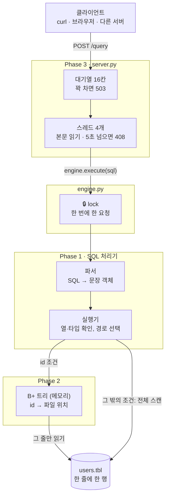
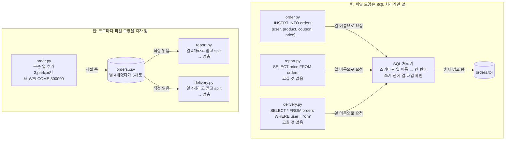
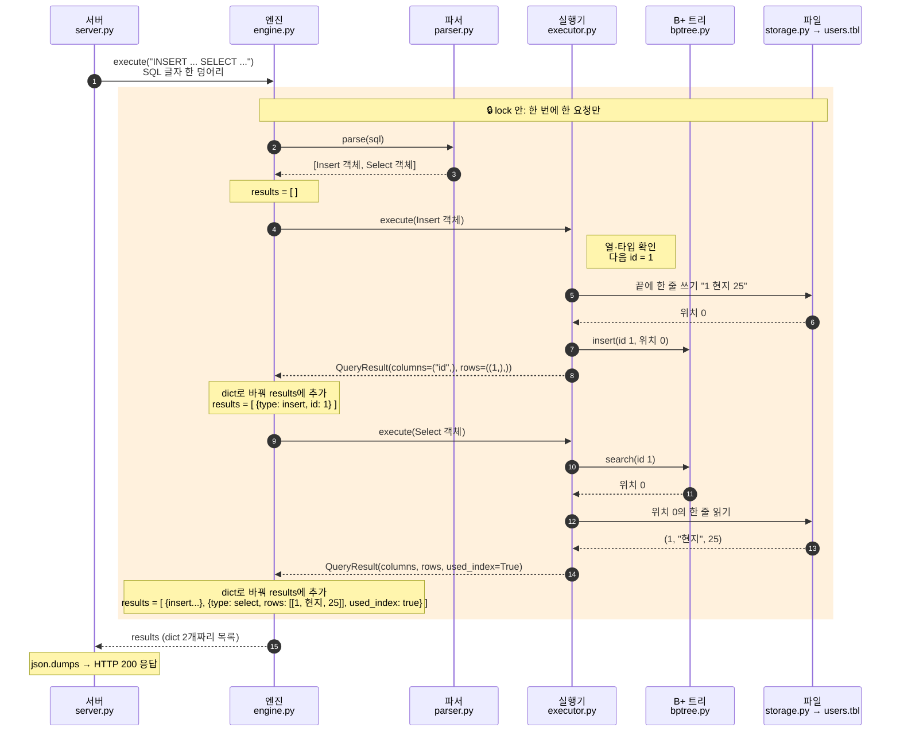

# 미니 DBMS 구현

SQL 문장을 받아 데이터를 파일에 저장하고, 원하는 데이터를 꺼내 주는 작은 데이터베이스(DBMS)를 **SQL 처리기부터 B+ 트리 인덱스, Thread Pool API 서버까지 외부 라이브러리 없이** 직접 만들었습니다.

```sql
INSERT INTO users (name, age) VALUES ('현지', 25);   -- 저장: users.tbl 파일에 한 줄 추가 (id는 자동으로 1)
SELECT * FROM users WHERE id = 1;                   -- 꺼내기: B+ 트리로 위치를 찾아 그 한 줄만 읽음 → 1, 현지, 25
```

**mini-redis와 무엇이 다른가요?** [mini-redis](https://github.com/team1-mini-lab/mini-redis)는 키 하나로 값 하나를 꺼내는 캐시라, 요청마다 스레드를 만들고 저장소에 lock 하나만 둬도 충분했습니다. lock 안의 일이 메모리의 해시 테이블 조회 하나로 아주 짧기 때문입니다. DBMS는 꺼져도 데이터가 남게 파일에 쓰고, 키 하나가 아니라 열과 범위로도 찾아야 합니다. 그래서 세 가지를 따로 풀었습니다.

**1. 데이터의 모양 (Phase 1).** 어떤 열이 몇 번째 칸에 있는지를 여러 코드가 각자 알고 있으면, 열 하나가 추가되거나 바뀔 때 그 파일을 읽는 코드를 전부 고쳐야 합니다. 그래서 파일의 모양은 SQL 처리기 한 곳만 알게 했습니다. 다른 코드는 열 이름으로 요청하고, 열 이름을 칸 번호로 바꾸는 일과 쓰기 전에 열과 타입을 확인하는 일은 처리기가 맡습니다. [→ 전과 후 그림](#파일-모양은-왜-sql-처리기-한-곳만-아나요)

**2. 많은 행 (Phase 2).** 목차가 없으면 100만 건을 처음부터 훑습니다(1,364ms). INSERT 때 자동으로 붙는 id와 그 줄의 파일 위치를 목차(B+ 트리)에 적어 두고, 찾을 때 그 줄만 읽습니다(0.032ms). 목차는 메모리에 두고 켤 때 파일로 다시 만듭니다. 해시 테이블은 키 하나는 빠르지만 순서를 몰라 범위를 못 찾고, 이진 탐색 트리는 순서대로 들어오는 id에서 한쪽으로 기울어서, 균형을 유지하며 범위도 찾는 B+ 트리를 골랐습니다. [→ 왜 B+ 트리인가](#왜-해시-테이블이-아니라-b-트리인가요)

**3. 동시에 오는 요청 (Phase 3).** 요청을 한 명씩 받으면 느린 연결(접속만 하고 요청을 다 보내지 않는 클라이언트) 하나에 모두가 막혀서, 여러 스레드가 받게 했습니다. 그러자 두 INSERT가 같은 id를 받아서, 엔진 입구에 lock을 걸어 한 번에 한 요청씩 실행합니다. 실행이 한 번에 하나라 스레드를 늘려도 빨라지지 않으므로, 스레드 4개와 대기열 16칸까지만 받고 넘치면 바로 503으로 "바쁘다"고 답합니다. [→ lock은 어디에](#서버-엔진-실행기는-각자-무엇을-하나요) · [→ 무엇이 느릴 수 있나](#무엇이-느릴-수-있고-각각-무엇으로-막았나요)

### 한눈에



세 가지는 맞물립니다. Thread Pool이 요청을 동시에 받게 만들고, 그래서 생긴 id 겹침을 lock이 막고, lock 안에 머무는 시간은 B+ 트리가 짧게 해 줍니다.

## 실행 및 시연

Python 3.10 이상이면 됩니다. 실행에 필요한 외부 패키지는 없습니다 (테스트에만 pytest).

### 1. 100만 건 성능 비교 (Phase 2)
```bash
python3 bench/run_bench.py 10000 100000    # 빠르게 보기
python3 bench/run_bench.py                 # 1만, 10만, 100만 건 (100만 건은 약 1분, 메모리 약 1.7GB)
```
| 건수 | 넣기 | 켜기(B+ 트리 다시 만들기) | 트리 높이 | id로 찾기 (인덱스) | name으로 찾기 (전체 스캔) | 배 |
|---:|---:|---:|---:|---:|---:|---:|
| 1,000,000 | 48.4초 | 1.87초 | 5 | 0.032ms | 1364.1ms | 43,094배 |

측정 방법과 1만·10만 건 결과는 [phase2](docs/phase2.md)에 있습니다.

### 2. API 서버 (Phase 3)
```bash
python3 server.py                          # http://localhost:8000 (브라우저로 열면 테스트 페이지)
curl -s -X POST localhost:8000/query -d '{"sql": "SELECT * FROM users WHERE id > 1;"}'
curl -s localhost:8000/stats               # 스레드·대기열 상태, 503으로 돌려보낸 수
```

### 3. lock이 없을 때와 있을 때 (동시성)
```bash
python3 checks/check_concurrency.py        # 스레드 100개가 동시에 INSERT
```
lock을 끄면 여러 행이 같은 id를 받고, 켜면 id가 1~100으로 정확히 나옵니다.

### 4. 대기열이 차면 503
```bash
python3 server.py --workers 1 --queue 1    # 터미널 1: 스레드 1개, 대기열 1칸
```
```bash
# 터미널 2: 느린 연결 2개로 스레드와 대기열을 채운 뒤 세 번째 요청 → 바로 503 busy
(sleep 3 | nc localhost 8000 &) && (sleep 3 | nc localhost 8000 &) && sleep 0.3 && \
curl -s -X POST http://localhost:8000/query -d '{"sql": "SELECT * FROM users;"}'
```

<details>
<summary>더 보기: 스레드가 여럿인 이득 · 동시 요청 6개 · 시뮬레이터</summary>

**스레드가 여럿인 이득.** 느린 연결 하나를 걸어 두고 조회를 보냅니다. `python3 server.py --workers 1`이면 약 4.7초(느린 연결이 408로 끊길 때까지), 기본값(스레드 4개)이면 바로 답이 옵니다.
```bash
(sleep 3 | nc localhost 8000 &) ; sleep 0.3
time curl -s -X POST localhost:8000/query -d '{"sql": "SELECT * FROM users WHERE id = 1;"}'
```

**동시 요청 6개.** 응답의 `id`는 겹치지 않고(lock), 서버 로그에는 `[worker-1]`~`[worker-4]`가 섞여 나옵니다(Thread Pool).
```bash
for i in 1 2 3 4 5 6; do curl -s -X POST http://localhost:8000/query -d "{\"sql\": \"INSERT INTO users (name, age) VALUES ('u$i', $i);\"}" & done; wait
```

**시뮬레이터.** [`docs/study/threadpool_simulator.html`](docs/study/threadpool_simulator.html)을 내려받아 브라우저로 열면, 스레드 4개가 대기열에서 요청을 꺼내 가고, lock 앞에서 한 명씩 차례를 기다리고, 다 차면 503이 나는 모습을 눌러 볼 수 있습니다.

</details>

### 파일 모양은 왜 SQL 처리기 한 곳만 아나요?



전에는 세 코드가 각자 "열 4개, 4번째가 가격"이라고 알고 파일을 직접 열어서, 한 코드가 열을 추가하는 순간 나머지가 멈춥니다. 후에는 모두 열 **이름**으로만 요청하고, 그 이름이 몇 번째 칸인지는 SQL 처리기만 압니다. 열이 늘어도 스키마만 바뀌고 다른 코드는 고칠 게 없습니다. `(age, name)` 순서로 넣어도 스키마 순서 `[id, name, age]`로 저장되고, 문법이 틀린 문장이 섞이면 아무 문장도 실행하지 않습니다. 이 예시는 [왜 DBMS인가](docs/study/WHY_DBMS/WHY_DBMS.md)의 문제 1입니다.

### 왜 해시 테이블이 아니라 B+ 트리인가요?


- mini-redis의 해시 테이블은 키 하나를 찾는 데는 가장 빠르지만 순서를 모릅니다. DB는 `id`가 2~5인 것처럼 범위와 순서가 필요해서, 맨 아래 노드끼리 이어진 B+ 트리를 골랐습니다. `WHERE id > 1`, `id <= 5` 같은 범위 조건도 B+ 트리의 `range_search`로 찾습니다.
- 이진 탐색 트리도 순서는 알지만, id가 1, 2, 3… 순서대로 들어오면 한쪽으로만 길어져 결국 줄 하나처럼 됩니다. B+ 트리는 노드가 차면 나뉘며 균형을 유지해서 100만 건에서도 높이가 5입니다.
- 트리에는 행이 아니라 **파일 위치만** 담습니다. 100만 줄을 메모리에 두 벌 두지 않고, 켤 때 데이터 파일로 다시 만들어 항상 일치시킵니다 (100만 건에 약 1.9초. 서버는 켤 때 미리 만들어 첫 요청이 기다리지 않게 함).
- id가 순서대로만 들어와서, 나뉜 왼쪽 노드는 다시 채워지지 않고 절반만 찹니다. 직접 만들어 보고 안 한계입니다.

### 서버, 엔진, 실행기는 각자 무엇을 하나요?

- **서버** (`server.py`): 연결을 받아 스레드에 나눠 주고, 엔진이 준 결과를 JSON으로 바꿔 돌려줍니다. SQL은 모릅니다.
- **엔진** (`engine.py`): 요청 **하나**(SQL 글자 한 덩어리)를 받아 lock을 잡고, 파싱해서 나온 문장들을 차례로 실행기에 넘기고, 결과를 dict로 바꿔 모은 뒤 lock을 놓습니다.
- **실행기** (`minidb/executor.py`): 파싱된 문장 **하나**를 받아 열과 타입을 확인하고, B+ 트리나 전체 스캔으로 파일을 읽거나 써서 `QueryResult`(열 이름, 행, B+ 트리를 썼는지)를 돌려줍니다.



서버를 안내 데스크, 엔진을 건물의 유일한 출입문으로 나눴습니다. 서버는 SQL을 받아 `engine.execute(sql)`에 넘기기만 하고, 엔진은 그 문에 자물쇠(lock)를 달아 한 번에 한 요청만 들여보냅니다.

잠가야 하는 건 실행기가 다음 id 번호, B+ 트리, 파일 객체를 여러 요청과 함께 쓰기 때문입니다. INSERT는 "다음 id 읽기 → 파일에 쓰기 → id 올리기" 세 단계라, 사이에 다른 스레드가 끼면 같은 id를 받습니다. SELECT도 테이블마다 파일 객체가 하나뿐이라, "그 위치로 이동 → 한 줄 읽기" 사이에 다른 스레드가 끼면 엉뚱한 줄을 읽습니다. 그래서 문장 하나는 통째로 잠가야 합니다. 실행기가 아니라 엔진에 건 이유는 세 가지입니다.

1. **요청 하나를 묶으려고.** 실행기는 문장 하나만 받습니다. 요청 하나에 든 여러 문장 사이에 다른 요청이 끼지 않게 하려면, 그 문장들을 차례로 넘기는 엔진에서 잠가야 합니다.
2. **실행기를 고치지 않으려고.** 문에서 이미 한 명씩만 들여보내니, 안쪽(파서, 실행기, B+ 트리, 파일)은 "한 번에 한 명"이라는 전제가 그대로 맞아 기존 코드를 고치지 않고 씁니다.
3. **동시성은 서버가 만든 문제라서.** CLI(`python -m minidb`)는 스레드가 하나라 lock이 필요 없습니다. 여러 스레드는 서버가 생기면서 생겼으니, 서버가 들어오는 입구인 엔진이 lock을 맡습니다.

### 무엇이 느릴 수 있고, 각각 무엇으로 막았나요?

"느리다"는 세 가지로 나뉘고, 막는 장치도 각각 다릅니다.

| 무엇이 느린가 | 언제 (lock 안/밖) | 예시 | 막는 장치 | 결과 |
| --- | --- | --- | --- | --- |
| **느린 연결**: 접속은 했는데 요청을 다 보내지 않은 클라이언트 | 받기 (lock 밖) | 느린 휴대폰 망, 보내다 멈춘 버그 | 스레드 4개 (3개까지 견딤), 5초 넘으면 408로 끊기 | 다른 요청 0.7ms |
| **느린 쿼리 (id 조건)** | 실행 (lock 안) | `WHERE id = 7`, `id > 990000` | B+ 트리 | 1,364ms → 0.032ms |
| **느린 쿼리 (id가 아닌 조건)** | 실행 (lock 안) | `WHERE name = '현지'`, `age > 20` | **없음.** 목차가 id에만 있어 전체 스캔 | 1,364ms 동안 다른 요청도 차례를 기다림 |

마지막 줄이 남은 문제입니다. 무거운 쿼리가 lock을 오래 잡는 동안 요청이 쌓이므로, 대기열은 16칸까지만 받고 넘치면 바로 503으로 돌려보내 서버가 무너지지 않게 했습니다. B+ 트리는 느린 쿼리를 **줄이는** 장치이고, 대기열 한도와 503은 그래도 남은 느린 쿼리가 터졌을 때 **버티는** 장치입니다.

평소 요청은 빠릅니다. INSERT 한 건은 약 0.05ms(100만 건 48.4초), id 조회는 0.032ms입니다. mini-redis와 갈리는 건 "평소에 느리다"가 아니라 "가끔 lock을 1초 넘게 잡는 쿼리가 있을 수 있다"는 점입니다. mini-redis의 명령은 모두 메모리 해시 조회 하나라 그런 명령이 없습니다.

### 왜 기본 스레드는 4개인가요?


- 느린 연결은 스레드 하나를 붙잡습니다. 스레드가 느린 연결보다 **많으면** 남는 스레드가 다른 요청을 받고(0.7ms), **같으면** 모두 붙잡혀 다들 기다립니다(664ms). 그래서 4개 = "느린 연결 3개까지 견딤". 측정은 `python3 bench/load_test.py B`(느린 연결 K개 + 빠른 요청 60개).
- 더 늘려도 빨라지지 않습니다. SQL 실행은 lock 안에서 한 번에 하나씩이라, 빠른 요청만 있을 때 스레드 1·4·16개가 44·70·68ms로 거의 같았습니다.
- 대기열 16칸은 짧으면 거절이 많고 길면 오래 기다리므로 그 사이에서 정한 판단입니다. 재 보니 4칸과 16칸은 거의 같았습니다([D35](docs/eungi/DECISIONS.md#step15)).
- 대기열은 직접 만들었습니다. 꽉 차면 바로 거절해야 하는데, 끝이 없는 대기열은 거절을 못 해서 요청 1000개 중 386개가 시간 초과로 실패했습니다. 직접 만든 대기열은 차는 순간 503을 보내 1.9초 만에 정리했습니다([D34](docs/eungi/DECISIONS.md#step15)).

스레드 수와 대기열 칸 수는 `--workers`, `--queue`로 바꿀 수 있습니다.

### 왜 실제 Redis처럼 스레드 하나(이벤트 루프)로 하지 않았나요?

실제 Redis는 스레드 하나가 여러 연결을 번갈아 보며, 느린 연결 앞에서 기다리지 않고 도착한 만큼만 처리합니다. 대신 명령 하나가 길면 그동안 모든 연결이 멈춥니다. Redis는 명령이 모두 짧아서 이 방식이 맞지만, 우리는 전체 스캔처럼 1초 넘게 걸리는 쿼리가 있을 수 있어서, 느린 연결은 스레드 여럿이 나눠 받고 실행만 lock으로 한 번에 하나씩 하는 Thread Pool을 골랐습니다.

### 요청이 틀렸을 때 서버는 어디서 무엇이라고 답하나요?


<details>
<summary>글로 보기</summary>

요청은 관문 7개를 차례로 지납니다. 답의 모양은 모두 `{"error": {"code", "message"}}` 하나입니다.

| 관문 | 서버가 묻는 것 | 걸리면 |
| --- | --- | --- |
| ① 들어오기 | 받을 자리가 있나? | 503 `busy` |
| ② 받기 | 5초 안에 다 보냈나? | 408 `timeout` |
| ③ 크기 | 너무 크지 않나? (본문 1MB까지) | 413 `too_large` |
| ④ 형식 | HTTP 모양, Content-Length, JSON이 맞나? | 400 `bad_request` |
| ⑤ 주소·방식 | `POST /query`인가? | 404 / 405 |
| ⑥ SQL | SQL이 맞나? | 400 `bad_sql` + 앞 문장 결과 |
| ⑦ 실행 | 서버가 고장 나지 않았나? (파일 손상 포함) | 500 `internal` (자세한 내용은 로그에만) |

①\~⑥은 클라이언트 쪽 문제, ⑦만 서버 쪽 문제입니다. 받는 쪽 프로그램은 `error.code` 하나만 보고 "다시 보낼지, 보여 줄지, 관리자에게 알릴지"를 정합니다.

</details>

## 지원 SQL

```sql
INSERT INTO students (name, grade) VALUES ('Kim', 3);
INSERT INTO students VALUES ('Lee', 2);          -- 컬럼 생략 시 id 를 뺀 스키마 순서
SELECT * FROM students;
SELECT name, grade FROM students WHERE grade >= 2;
SELECT * FROM users WHERE id > 100;              -- id 범위 조건은 B+ 트리로
```

- 테이블 정의는 `data/schema.json`에 미리 적습니다 (`CREATE TABLE` 없음). 타입은 `INT`, `TEXT`. 첫 컬럼은 반드시 `id INT`이며 값은 자동 부여됩니다.
- 키워드는 대소문자 무관, 식별자는 소문자로 정규화. 문자열은 작은따옴표, 따옴표 자체는 `''`. 문장은 `;`로 끝나며 주석은 `--`.
- `WHERE`는 `컬럼 연산자 값` 하나만. 연산자는 `=` `!=` `<` `<=` `>` `>=`.
- 문법 오류가 하나라도 있으면 아무 문장도 실행하지 않습니다. 실행 오류가 나면 그 문장에서 멈추고, 앞 문장은 되돌리지 않습니다.

**SQL 파일로 실행하기 (CLI)**
```bash
python3 -m minidb examples/students.sql
python3 -m minidb q.sql --data-dir /tmp/mydb --schema data/schema.json
```
종료 코드: 0 성공, 1 입력 문제(파일 없음, 문법 오류), 2 실행 문제(없는 테이블, 타입 불일치, 손상된 행). 결과는 표준 출력, 오류는 표준 에러.

## 테스트

```bash
pip install -r requirements-dev.txt && pytest   # 313개 (SQL 처리기·B+ 트리·엔진·서버)
python3 checks/check_errors.py                  # 오류 응답 (400·404·405·408·413·500·503)
python3 checks/check_guard.py                   # 엣지 방어 (느린 연결, Content-Length, 끄기)
```

## 실제 DBMS와의 차이

<details>
<summary>MySQL·PostgreSQL과 무엇이 다르고, 왜 이렇게 만들었나</summary>

| 부분 | 실제 DBMS (MySQL, PostgreSQL) | mini-dbms | 그렇게 한 이유 |
| --- | --- | --- | --- |
| SQL 처리 | 토큰 → 구문 트리 → 실행 계획을 비교해 가장 빠른 방법 선택 | 토큰 → 구문 트리 → 바로 실행. id 조건이면 인덱스, 아니면 전체 스캔 | 테이블 하나를 조회하는 문장이라, 옵티마이저 없이도 SQL 처리 원리를 구현하기에 충분함 |
| 저장 방식 | 8\~16KB 페이지 단위. 자주 쓰는 페이지는 메모리에 캐시(버퍼 풀) | 한 줄에 한 행, 값은 탭으로 나눠 파일 끝에 붙임 | 파일을 눈으로 바로 확인할 수 있고, 값에 쉼표나 한글이 들어가도 깨지지 않음 |
| 인덱스 | B+ 트리를 디스크 페이지에 저장. 켤 때 다시 만들지 않음 | B+ 트리가 메모리에만 있음. 켤 때 파일을 읽어 다시 만듦 | 데이터 파일을 기준으로 다시 만들면 비정상 종료 뒤에도 항상 일치함 |
| 동시성 | 행 단위 잠금 + 읽는 쪽이 옛 버전을 보는 방식(MVCC) | 엔진 lock 하나[^1] | 기존 행을 고치지 않아 경합 지점이 다음 번호·파일 끝·인덱스뿐. 교착 상태가 없음. 대신 느린 쿼리는 다른 요청을 기다리게 함 |
| 트랜잭션·복구 | 여러 문장을 "모두 되거나 모두 안 되게" 묶음. 쓰기 전에 로그를 남겨(WAL) 꺼져도 복구 | 없음. 문장마다 바로 저장. 쓰다 만 마지막 줄만 켤 때 잘라 냄 | 파서·인덱스·서버에 집중. 대신 실행 중 오류면 앞 문장까지의 결과를 돌려줘 중복 재시도를 막음 |
| 연결 처리 | 자체 통신 방식 + 스레드 풀이나 프로세스 | HTTP + JSON + 직접 만든 Thread Pool | 브라우저·`curl`로 별도 드라이버 없이 테스트할 수 있고, 대기열 상한으로 503 과부하 방어를 직접 제어함 |
| 오류 | 표준 오류 코드(SQLSTATE) | 정해 둔 JSON 코드 `bad_sql`, `busy` 등 | `error.code` 하나로 원인을 구분하고, SQL 실수(400)와 서버 장애(500)를 나눠 내부 경로가 밖으로 나가지 않게 함 |

</details>

[^1]: 실제 DB의 행 단위 잠금은 기존 행을 고칠 때 그 행만 잠그는 방식입니다. 우리는 `UPDATE`·`DELETE`가 없어 고칠 행이 없고, INSERT끼리 다투는 건 테이블에 하나뿐인 다음 번호·파일 끝·B+ 트리입니다. SELECT끼리는 동시에 하게(읽기·쓰기 lock) 풀면 빨라질지도 재 봤는데, 1만 줄 전체 스캔 16개를 스레드 4개로 돌리니 209ms → 1,700ms로 오히려 느려졌습니다. 파이썬은 GIL 때문에 한 번에 한 스레드만 코드를 실행해서, 차례를 바꾸는 비용만 늘었습니다 ([STEP16](docs/eungi/STEP16.md)).

## 한계

- 인덱스는 `id`에만 있습니다. `name`, `age` 같은 다른 열로 찾으면 전체 스캔이고(100만 건에 1,364ms), 그동안 lock을 잡고 있어 다른 요청도 기다립니다. 다른 열에도 B+ 트리(보조 인덱스)를 만들 수 있지만, 같은 값이 여러 행에 있을 수 있고 INSERT마다 인덱스를 하나씩 더 고쳐야 해서 이번 범위에서는 하지 않았습니다.
- 같은 데이터 폴더에 한 번에 한 프로세스만 쓴다고 가정합니다. 서버는 lock으로 요청을 한 번에 하나씩 실행하지만, 서버가 켜진 채로 같은 폴더에 CLI로 쓰는 것은 막지 못합니다.
- 범위가 넓으면(`id > 0`) 줄마다 위치로 읽어서 전체 스캔보다 느릴 수 있습니다. 비용을 따져 경로를 고르는 기능은 없습니다.
- 100만 건을 CLI로 넣을 때 메모리를 약 1.7GB 씁니다 (파일 전체를 먼저 해석하는 구조).
- `CREATE TABLE`, `UPDATE`, `DELETE`, NULL, `AND`/`OR`, `ORDER BY`, `LIMIT`, JOIN, 트랜잭션, WAL은 지원하지 않습니다.

## 문서

| 문서 | 이럴 때 읽기 |
| --- | --- |
| [왜 DBMS인가](docs/study/WHY_DBMS/WHY_DBMS.md) | DBMS가 어떤 문제를 풀려고 나왔는지 폴더 하나 예시로 보고 싶을 때. **처음이면 여기부터** |
| [전체 그림](docs/study/OVERVIEW.md) | SQL 한 줄이 파일에 저장되고 다시 꺼내지기까지를 코드로 따라가고 싶을 때 |
| [설계](docs/DESIGN.md) | 단계별로 무엇을 만들고, 언제 완료인지 볼 때 |
| [Phase 1 단계 문서](docs/steps/) | 토크나이저부터 엣지 케이스까지, SQL 처리기의 단계별 설계와 결정 |
| [Phase 2](docs/phase2.md) | B+ 트리를 실행기에 붙인 방법, 범위 검색, 100만 건 성능 비교 |
| [Phase 3](docs/eungi/) | Thread Pool([STEP15](docs/eungi/STEP15.md)), lock([STEP16](docs/eungi/STEP16.md)), 오류 응답([STEP17](docs/eungi/STEP17.md)) |
| [결정 기록](docs/eungi/DECISIONS.md) | "왜 이렇게 만들었나"를 결정 번호로. Phase 1(H1\~H12), Phase 2(S1\~S7), Phase 3(D30\~D48) |
| [학습 노트](docs/study/DBMS_study.md) | "왜 이렇게 만드나"를 설명할 수 있는지 스스로 확인할 때 |
| [과제 요구사항](docs/REQUIREMENTS.md) | 과제 원문 |
