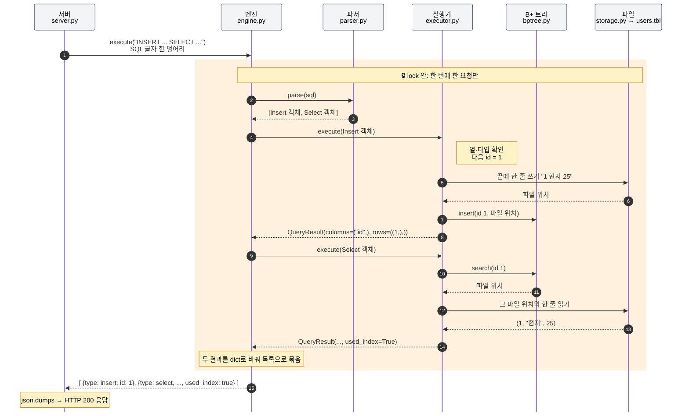

# 미니 DBMS 구현

SQL 문장을 받아 데이터를 파일에 저장하고, 원하는 데이터를 꺼내 주는 작은 데이터베이스(DBMS)를 **SQL 처리기부터 B+ 트리 인덱스, Thread Pool API 서버까지 외부 라이브러리 없이** 직접 만들었습니다.

```sql
INSERT INTO users (name, age) VALUES ('현지', 25);   -- 저장: users.tbl 파일에 한 줄 추가 (id는 자동으로 1)
SELECT * FROM users WHERE id = 1;                   -- 꺼내기: B+ 트리로 위치를 찾아 그 한 줄만 읽음 → 1, 현지, 25
```

[mini-redis](https://github.com/team1-mini-lab/mini-redis)는 키 하나로 값 하나를 꺼내는 메모리 캐시였습니다. DBMS는 꺼져도 데이터가 남게 파일에 쓰고, 키 하나가 아니라 열과 범위로도 찾고, 여러 사람이 동시에 씁니다. 그래서 세 가지 문제를 풀었습니다.

**1. 데이터의 모양 (Phase 1).** 어떤 열이 몇 번째 칸에 있는지를 여러 코드가 각자 알고 있으면, 열 하나가 추가되거나 바뀔 때 그 파일을 읽는 코드를 전부 고쳐야 합니다. 그래서 파일의 모양은 SQL 처리기 한 곳만 알게 했습니다. 다른 코드는 열 이름으로 요청하고, 열 이름을 칸 번호로 바꾸는 일, 그리고 잘못된 값(없는 열, 숫자 칸에 글자)이 파일에 들어가기 전에 막는 일은 처리기가 맡습니다. [→ 코드로 보기](#phase-1-파일-모양은-왜-sql-처리기-한-곳만-아나요)

**2. 많은 행 (Phase 2).** 목차가 없으면 100만 건을 처음부터 훑습니다(1,364ms). INSERT 때 자동으로 붙는 id와 그 줄의 파일 위치를 메모리의 목차(B+ 트리)에 적어 두고, 찾을 때 그 줄만 읽습니다(0.032ms). DB는 `id > 990000`처럼 범위를 묻는데, 해시 테이블은 키를 칸마다 흩어 두어 범위를 찾으려면 전부 봐야 합니다. 그래서 키를 정렬해 이웃끼리 이어 두는 B+ 트리를 골랐습니다. [→ 왜 B+ 트리인가](#phase-2-왜-해시-테이블이-아니라-b-트리인가요)

**3. 동시에 오는 요청 (Phase 3).**
- **스레드 4개가 병렬로 처리합니다** → 요청 받기와 응답 보내기는 동시에 하고, 데이터를 만지는 실행만 한 줄로 섭니다. 그래서 접속만 하고 요청을 다 보내지 않는 느린 연결 하나에 모두가 막히지 않습니다.
- **실행은 lock으로 한 번에 하나씩** → 동시에 들어온 두 INSERT가 같은 id를 받지 않게.
- **그래서 스레드 수를 정했습니다** → 실행이 하나씩이라 스레드를 늘려도 빨라지지 않고, 긴 쿼리가 오면 그동안 요청이 쌓입니다. mini-redis는 처리가 키 조회 정도로 짧아 요청마다 스레드를 만들어도 금방 끝났지만, DBMS는 실행이 길 수 있어 스레드 4개와 대기열 16칸까지만 받고 넘치면 바로 503으로 돌려보냅니다.

[→ lock은 어디에](#phase-3-서버엔진실행기를-어떻게-나누고-lock은-어디에-두었나요) · [→ 스레드 수는 왜](#phase-3-스레드는-왜-여럿이고-왜-4개와-16칸인가요)


## 실행 및 시연

Python 3.10 이상이면 됩니다. 실행에 필요한 외부 패키지는 없습니다 (테스트에만 pytest).

### 1. SQL 처리기: SQL 파일을 CLI로 (Phase 1)
```bash
python3 -m minidb examples/step1.sql --data-dir /tmp/demo --schema data/schema.json   # INSERT 2개 + SELECT
python3 -m minidb examples/step2.sql --data-dir /tmp/demo --schema data/schema.json   # 다시 실행해 id = 2 조회
```
```
1 row inserted (id=1)
1 row inserted (id=2)
id | name | age
---+------+----
1  | 현지 | 25
2  | 민수 | 31
```
데이터는 `/tmp/demo/users.tbl`에 한 줄씩 저장되어, 프로그램을 다시 실행해도 남아 있고 id로 바로 찾습니다. 종료 코드는 0 성공, 1 입력 문제(파일 없음, 문법 오류), 2 실행 문제(없는 테이블, 타입 불일치)입니다. 같은 SQL 처리기를 3번의 API 서버도 그대로 씁니다(`curl`로 SQL을 보내면 같은 결과가 JSON으로 옴).

### 2. 100만 건 성능 비교 (Phase 2)
```bash
python3 bench/run_bench.py 10000 100000    # 빠르게 보기
python3 bench/run_bench.py                 # 1만, 10만, 100만 건 (100만 건은 약 1분, 메모리 약 1.7GB)
```
| 건수 | 넣기 | 켜기(B+ 트리 다시 만들기) | 트리 높이 | id로 찾기 (인덱스) | name으로 찾기 (전체 스캔) | 배 |
|---:|---:|---:|---:|---:|---:|---:|
| 1,000,000 | 48.4초 | 1.87초 | 5 | 0.032ms | 1364.1ms | 43,094배 |

INSERT 100만 줄을 만들어 CLI로 넣고, 같은 데이터에서 두 경로의 시간을 잽니다([측정 방법](docs/phase2.md)).

### 3. API 서버와 동시성 (Phase 3)
```bash
python3 server.py                          # http://localhost:8000 (브라우저로 열면 테스트 페이지)
curl -s -X POST localhost:8000/query -d '{"sql": "SELECT * FROM users WHERE id > 1;"}'
curl -s localhost:8000/stats               # 스레드·대기열 상태, 503으로 돌려보낸 수
```

**lock이 없을 때와 있을 때.** 스레드 100개가 동시에 INSERT합니다. lock을 끄면 여러 행이 같은 id를 받고, 켜면 1~100이 정확히 나옵니다.
```bash
python3 checks/check_concurrency.py
```

**느린 연결이 있어도 다른 요청은 바로 답을 받나요?** 서버에 접속만 하고 아무것도 보내지 않는 클라이언트(`nc`)를 하나 만든 뒤, 바로 조회를 보냅니다.
- 스레드 1개(`python3 server.py --workers 1`): 하나뿐인 스레드가 그 클라이언트를 기다리느라, 조회는 약 4.7초 뒤에 답을 받습니다. 감시 스레드가 5초 동안 요청을 다 보내지 않은 연결을 408로 끊은 뒤에야 차례가 옵니다.
- 스레드 4개(기본값): 남은 스레드가 조회를 받아 바로 답합니다.
```bash
(sleep 3 | nc localhost 8000 &) ; sleep 0.3
time curl -s -X POST localhost:8000/query -d '{"sql": "SELECT * FROM users WHERE id = 1;"}'
```

**요청이 몰릴 때.** 실행은 lock으로 한 번에 하나라 요청이 몰리면 줄이 생깁니다. 그 줄은 스레드 수와 대기열 칸 수로 제어해서, 다 차면 기다리게 하지 않고 바로 503으로 돌려보냅니다. 재현 방법은 [품질](#품질-테스트와-엣지-케이스)에 있습니다.

## 설계: 왜 이렇게 만들었나

### Phase 1: 파일 모양은 왜 SQL 처리기 한 곳만 아나요?

어떤 열이 몇 번째 칸에 있는지를 여러 코드가 각자 알고 있으면, 열 하나가 바뀔 때 그 파일을 읽는 코드를 전부 고쳐야 합니다([왜 DBMS인가](docs/study/WHY_DBMS/WHY_DBMS.md)의 문제 1). 그래서 모양은 **한 파일**에만 적고, 그걸 읽는 건 **SQL 처리기**뿐입니다.

**① 모양은 `data/schema.json` 한 곳에만 있습니다.**
```json
"users": {"columns": [{"name": "id", "type": "INT"}, {"name": "name", "type": "TEXT"}, {"name": "age", "type": "INT"}]}
```

**② INSERT: 사용자가 쓴 순서를 스키마 순서로 바꿉니다** (`minidb/executor.py`)
```python
given = dict(zip(columns, stmt.values))          # {name: '지수', age: 30}  ← 사용자가 쓴 순서
...
return tuple(given[c] for c in table.user_columns)  # ('지수', 30)          ← 스키마 순서
```
```sql
INSERT INTO users (age, name) VALUES (30, '지수');   -- users.tbl에는 "1	지수	30"으로 저장
```

**③ SELECT: 열 이름을 칸 번호로 바꿔 꺼냅니다** (`minidb/executor.py`, `minidb/catalog.py`)
```python
out_indexes = [table.column_index(n) for n in out_names]   # ["age", "name"] → [2, 1]
rows = [tuple(row[i] for i in out_indexes) for row in candidates if predicate(row)]
```

`server.py`와 `engine.py`에는 칸 번호가 한 번도 나오지 않습니다. SQL을 그대로 넘기고, 열 이름으로 된 결과를 받을 뿐입니다. 그래서 열 순서가 바뀌어도 고칠 곳은 `schema.json` 한 줄과 처리기뿐이고, 파일에 쓰기 전에 열 이름이 스키마에 있는지, 빠진 열은 없는지, 값이 열의 타입(INT·TEXT)에 맞는지도 처리기 한 곳에서 확인해서, `age`에 `'스물'` 같은 값은 파일에 들어가기 전에 막힙니다. 단, `INSERT INTO users VALUES ('지수', 30)`처럼 열 이름을 생략하면 스키마 순서로 받으므로, 이때는 다시 순서에 기대게 됩니다.

### Phase 2: 왜 해시 테이블이 아니라 B+ 트리인가요?

DB에 오는 질문은 `id = 7`처럼 하나만 찾는 것보다, "최근 주문 1만 건"(`id > 990000`)처럼 **이보다 크거나 작은 것을 찾는 범위**가 많습니다. 범위를 찾으려면 "2 다음은 3"이라는 순서, 즉 이웃을 알아야 합니다.

```
해시 테이블   칸0 [4, 8]   칸1 [1, 5]   칸2 [2, 6]   칸3 [3, 7]
              → 2~5가 칸마다 흩어져 있어, 칸을 전부 봐야 함

B+ 트리 잎    [1, 2] → [3, 4] → [5, 6] → [7, 8]
              → 2를 찾아 내려간 뒤 오른쪽으로 따라가다, 5를 넘으면 멈춤
```

해시 테이블은 키 하나를 찾는 데는 가장 빠르지만(mini-redis), 키를 계산식으로 흩어 두어 이웃을 모릅니다. B+ 트리는 키를 정렬해 두고 맨 아래 노드(잎)끼리 `next_leaf`로 이어 두어서, 시작점만 찾으면 옆으로 따라가면 됩니다 (`minidb/bptree.py`).
```python
leaf = self._find_leaf(start)          # 시작값이 있을 잎까지 한 번만 내려감
i = bisect_left(leaf.keys, start)      # 잎 안에서 시작 위치
while leaf is not None:
    while i < len(leaf.keys):
        if leaf.keys[i] > end:         # 끝값을 넘으면 멈춤
            return result
        result.append((leaf.keys[i], leaf.values[i]))
        i += 1
    leaf = leaf.next_leaf              # 옆 잎으로 이동
    i = 0
```

실행기는 `WHERE id > 1`을 `range_search(2, ∞)`로 바꿔 부르고, 결과에 `used_index: true`를 붙입니다. id가 아닌 열(`name`, `age`)은 목차가 없어 전체 스캔합니다.

- **메모리에 위치만:** 트리에는 행이 아니라 파일 위치만 담고, 켤 때 데이터 파일로 다시 만들어 항상 일치시킵니다(100만 건에 약 1.9초, 서버는 켤 때 미리 만듦).
- **직접 만들어 보고 안 한계:** id가 순서대로만 들어와서, 나뉜 왼쪽 노드는 다시 채워지지 않고 절반만 찹니다.

### Phase 3: 서버·엔진·실행기를 어떻게 나누고, lock은 어디에 두었나요?

가장 오래 고민한 부분입니다. 서버(네트워크)와 SQL 처리기(데이터)는 하는 일이 달라서 나눴고, 나누자 "둘을 무엇으로 이을까, lock은 어디에 둘까"를 정해야 했습니다.

- **서버와 엔진을 나눔.** 서버는 네트워크만, 엔진은 SQL만 압니다. 같은 처리기를 CLI와 서버가 함께 쓰고, 따로 테스트하고, 한쪽을 바꿔도 다른 쪽은 그대로입니다.
- **잇는 곳은 `engine.execute(sql)` 하나.** 엔진이 결과를 dict 목록으로 돌려주고, 서버는 그걸 JSON으로만 바꿉니다.
- **엔진은 전부 파싱한 뒤 실행기에 하나씩.** SQL을 문장 객체(AST)로 만든 뒤 넘겨서, 문법이 틀린 문장이 섞이면 하나도 실행하지 않습니다.
- **실행기는 문장 하나만.** 열·타입 확인, B+ 트리 또는 전체 스캔, 파일 읽고 쓰기. Phase 1·2 코드를 그대로 씁니다.
- **lock은 엔진 입구 한 곳.** 요청 하나(문장 여러 개)를 통째로 묶을 수 있고, 실행기는 고치지 않아도 되고, 스레드가 없는 CLI에는 붙지 않습니다.



**lock이 지키는 것:** 여러 요청이 함께 쓰는 다음 id, B+ 트리, 파일 객체입니다. INSERT("다음 id 읽기 → 쓰기 → id 올리기")나 SELECT("위치로 이동 → 읽기") 사이에 다른 스레드가 끼면 id가 겹치거나 엉뚱한 줄을 읽습니다.

### Phase 3: 스레드는 왜 여럿이고, 왜 4개와 16칸인가요?

**요청은 스레드 4개가 병렬로 처리하고, 데이터를 만지는 실행만 lock으로 한 줄로 섭니다.** 요청 하나는 "받기 → 실행 → 보내기"이고, 받기와 보내기는 서로 겹쳐도 됩니다.


<sub>시간은 설명용 단위입니다. 실제 측정은 아래 숫자를 보세요.</sub>

- **왜 여럿인가:** 접속만 하고 요청을 다 보내지 않는 느린 연결은 스레드 하나를 붙잡습니다. 스레드가 남아 있으면 다른 요청을 받습니다. 느린 연결 3개 + 스레드 4개면 다른 요청은 0.7ms, 4개가 다 붙잡히면 664ms였습니다. 그래서 4개(3개까지 견딤)이고, 5초 넘게 안 보내면 감시 스레드가 408로 끊어 스레드를 돌려받습니다.
- **왜 무한정 늘리지 않나:** 실행은 lock 때문에 한 번에 하나라 늘려도 빨라지지 않습니다. 빠른 요청만 있을 때 스레드 1·4·16개가 44·70·68ms로 같았습니다.
- **왜 대기열 16칸 + 503인가:** 실행이 한 줄이라 요청이 몰리면 줄이 생깁니다. 끝없이 받으면 다 같이 늦어지다 시간 초과로 실패해서(요청 1000개 중 386개), 16칸까지만 받고 넘치면 바로 503으로 돌려보냅니다(1.9초에 정리, [D34](docs/eungi/DECISIONS.md#step15)). 16칸은 판단이고, 4칸과 거의 같았습니다([D35](docs/eungi/DECISIONS.md#step15)).
- **느린 쿼리는:** 스레드가 아니라 B+ 트리가 줄입니다(id 조건 0.032ms). 목차가 없는 열의 전체 스캔(1,364ms)은 남은 문제라, 그동안 쌓이는 요청을 대기열 한도와 503이 버팁니다.
- **실제 Redis처럼 스레드 하나(이벤트 루프)가 아닌 이유:** 이벤트 루프는 느린 연결 앞에서 기다리지 않지만, 명령 하나가 길면 모든 연결이 멈춥니다. Redis는 명령이 모두 짧아 맞지만, 우리는 1초 넘는 쿼리가 있을 수 있습니다.

측정은 `python3 bench/load_test.py`, 설정은 `--workers`, `--queue`로 바꿉니다. [`docs/study/threadpool_simulator.html`](docs/study/threadpool_simulator.html)을 내려받아 열면 이 과정을 눌러 볼 수 있습니다.

## 품질: 테스트와 엣지 케이스

```bash
pip install -r requirements-dev.txt && pytest   # 단위 테스트 313개 (SQL 처리기·B+ 트리·엔진·서버)
python3 checks/check_all.py                     # 기능 테스트 (INSERT·SELECT·인덱스 사용·열 순서·재시작 뒤 id 이어짐)
python3 checks/check_threadpool.py              # Thread Pool (여러 스레드가 나눠 받기, 대기열 포화 시 503)
python3 checks/check_errors.py                  # 오류 응답 (400·404·405·408·413·500·503)
python3 checks/check_guard.py                   # 엣지 방어 (느린 연결, Content-Length, 끄기)
```

### 요청이 틀리면 어디서 무엇이라고 답하나요?

요청은 관문 7개를 차례로 지납니다. 답의 모양은 모두 `{"error": {"code", "message"}}` 하나입니다.

| 관문 | 서버가 묻는 것 | 걸리면 |
| --- | --- | --- |
| ① 들어오기 | 받을 자리가 있나? | 503 `busy` |
| ② 받기 | 5초 안에 다 보냈나? | 408 `timeout` |
| ③ 크기 | 너무 크지 않나? (본문 1MB까지) | 413 `too_large` |
| ④ 형식 | HTTP 모양, Content-Length, JSON이 맞나? | 400 `bad_request` |
| ⑤ 주소·방식 | `POST /query`인가? | 404 / 405 |
| ⑥ SQL | SQL이 맞나? | 400 `bad_sql` + 앞 문장 결과 |
| ⑦ 실행 | 서버가 고장 나지 않았나? (파일 손상 포함) | 500 `internal` (자세한 내용은 로그에만) |

①\~⑥은 클라이언트 쪽 문제, ⑦만 서버 쪽 문제입니다. 받는 쪽 프로그램은 `error.code` 하나만 보고 "다시 보낼지, 보여 줄지, 관리자에게 알릴지"를 정합니다.


예를 들어 스레드와 대기열을 모두 채우면 세 번째 요청은 바로 503을 받습니다.
```bash
python3 server.py --workers 1 --queue 1    # 터미널 1: 스레드 1개, 대기열 1칸
(sleep 3 | nc localhost 8000 &) && (sleep 3 | nc localhost 8000 &) && sleep 0.3 && \
curl -s -X POST http://localhost:8000/query -d '{"sql": "SELECT * FROM users;"}'   # 터미널 2
```

## 참고

### 쓸 수 있는 SQL 문법

<details>
<summary>INSERT · SELECT · WHERE 문법과 규칙</summary>

```sql
INSERT INTO students (name, grade) VALUES ('Kim', 3);
INSERT INTO students VALUES ('Lee', 2);          -- 컬럼 생략 시 id 를 뺀 스키마 순서
SELECT * FROM students;
SELECT name, grade FROM students WHERE grade >= 2;
SELECT * FROM users WHERE id > 100;              -- id 범위 조건은 B+ 트리로
```

- 테이블 정의는 `data/schema.json`에 미리 적습니다 (`CREATE TABLE` 없음). 타입은 `INT`, `TEXT`. 첫 컬럼은 반드시 `id INT`이며 값은 자동 부여됩니다.
- 키워드는 대소문자 무관, 식별자는 소문자로 정규화. 문자열은 작은따옴표, 따옴표 자체는 `''`. 문장은 `;`로 끝나며 주석은 `--`.
- `WHERE`는 `컬럼 연산자 값` 하나만. 연산자는 `=` `!=` `<` `<=` `>` `>=`.
- 문법 오류가 하나라도 있으면 아무 문장도 실행하지 않습니다. 실행 오류가 나면 그 문장에서 멈추고, 앞 문장은 되돌리지 않습니다.

</details>

### 실제 DBMS와의 차이

<details>
<summary>MySQL·PostgreSQL과 무엇이 다르고, 왜 이렇게 만들었나</summary>

| 부분 | 실제 DBMS (MySQL, PostgreSQL) | mini-dbms | 그렇게 한 이유 |
| --- | --- | --- | --- |
| SQL 처리 | 토큰 → 구문 트리 → 실행 계획을 비교해 가장 빠른 방법 선택 | 토큰 → 구문 트리 → 바로 실행. id 조건이면 인덱스, 아니면 전체 스캔 | 테이블 하나를 조회하는 문장이라, 옵티마이저 없이도 SQL 처리 원리를 구현하기에 충분함 |
| 저장 방식 | 8\~16KB 페이지 단위. 자주 쓰는 페이지는 메모리에 캐시(버퍼 풀) | 한 줄에 한 행, 값은 탭으로 나눠 파일 끝에 붙임 | 파일을 눈으로 바로 확인할 수 있고, 값에 쉼표나 한글이 들어가도 깨지지 않음 |
| 인덱스 | B+ 트리를 디스크 페이지에 저장. 켤 때 다시 만들지 않음 | B+ 트리가 메모리에만 있음. 켤 때 파일을 읽어 다시 만듦 | 데이터 파일을 기준으로 다시 만들면 비정상 종료 뒤에도 항상 일치함 |
| 동시성 | 행 단위 잠금 + 읽는 쪽이 옛 버전을 보는 방식(MVCC) | 엔진 lock 하나[^1] | 기존 행을 고치지 않아 경합 지점이 다음 번호·파일 끝·인덱스뿐. 교착 상태가 없음. 대신 느린 쿼리는 다른 요청을 기다리게 함 |
| 트랜잭션·복구 | 여러 문장을 "모두 되거나 모두 안 되게" 묶음. 쓰기 전에 로그를 남겨(WAL) 꺼져도 복구 | 없음. 문장마다 바로 저장. 쓰다 만 마지막 줄만 켤 때 잘라 냄 | 파서·인덱스·서버에 집중. 대신 실행 중 오류면 앞 문장까지의 결과를 돌려줘 중복 재시도를 막음 |
| 연결 처리 | 자체 통신 방식 + 스레드 풀이나 프로세스 | HTTP + JSON + 직접 만든 Thread Pool | 브라우저·`curl`로 별도 드라이버 없이 테스트할 수 있고, 대기열 상한으로 503 과부하 방어를 직접 제어함 |
| 오류 | 표준 오류 코드(SQLSTATE) | 정해 둔 JSON 코드 `bad_sql`, `busy` 등 | `error.code` 하나로 원인을 구분하고, SQL 실수(400)와 서버 장애(500)를 나눠 내부 경로가 밖으로 나가지 않게 함 |

</details>

[^1]: 실제 DB의 행 단위 잠금은 기존 행을 고칠 때 그 행만 잠그는 방식입니다. 우리는 `UPDATE`·`DELETE`가 없어 고칠 행이 없고, INSERT끼리 다투는 건 테이블에 하나뿐인 다음 번호·파일 끝·B+ 트리입니다. SELECT끼리는 동시에 하게(읽기·쓰기 lock) 풀면 빨라질지도 재 봤는데, 1만 줄 전체 스캔 16개를 스레드 4개로 돌리니 209ms → 1,700ms로 오히려 느려졌습니다. 파이썬은 GIL 때문에 한 번에 한 스레드만 코드를 실행해서, 차례를 바꾸는 비용만 늘었습니다 ([STEP16](docs/eungi/STEP16.md)).

### 한계

- 인덱스는 `id`에만 있습니다. 다른 열로 찾으면 전체 스캔이고(100만 건에 1,364ms), 그동안 lock을 잡고 있어 다른 요청도 기다립니다. 다른 열에도 B+ 트리(보조 인덱스)를 만들 수 있지만, 같은 값이 여러 행에 있을 수 있고 INSERT마다 인덱스를 하나씩 더 고쳐야 해서 이번 범위에서는 하지 않았습니다.
- 열을 추가하면 이미 저장된 줄은 칸 수가 맞지 않아 읽을 수 없습니다(손상된 행 오류). 옛 줄에 기본값을 채우는 기능(`ALTER TABLE`)은 없습니다.
- 같은 데이터 폴더에 한 번에 한 프로세스만 쓴다고 가정합니다. 서버가 켜진 채로 같은 폴더에 CLI로 쓰는 것은 막지 못합니다.
- 범위가 넓으면(`id > 0`) 줄마다 위치로 읽어서 전체 스캔보다 느릴 수 있습니다. 비용을 따져 경로를 고르는 기능은 없습니다.
- 100만 건을 CLI로 넣을 때 메모리를 약 1.7GB 씁니다 (파일 전체를 먼저 해석하는 구조).
- `CREATE TABLE`, `UPDATE`, `DELETE`, NULL, `AND`/`OR`, `ORDER BY`, `LIMIT`, JOIN, 트랜잭션, WAL은 지원하지 않습니다.

### 작업 문서

| 문서 | 이럴 때 읽기 |
| --- | --- |
| [왜 DBMS인가](docs/study/WHY_DBMS/WHY_DBMS.md) | DBMS가 어떤 문제를 풀려고 나왔는지 폴더 하나 예시로 보고 싶을 때. **처음이면 여기부터** |
| [전체 그림](docs/study/OVERVIEW.md) | SQL 한 줄이 파일에 저장되고 다시 꺼내지기까지를 코드로 따라가고 싶을 때 |
| [설계](docs/DESIGN.md) | 단계별로 무엇을 만들고, 언제 완료인지 볼 때 |
| [Phase 1 단계 문서](docs/steps/) | 토크나이저부터 엣지 케이스까지, SQL 처리기의 단계별 설계와 결정 |
| [Phase 2](docs/phase2.md) | B+ 트리를 실행기에 붙인 방법, 범위 검색, 100만 건 성능 비교 |
| [Phase 3](docs/eungi/) | Thread Pool([STEP15](docs/eungi/STEP15.md)), lock([STEP16](docs/eungi/STEP16.md)), 오류 응답([STEP17](docs/eungi/STEP17.md)) |
| [결정 기록](docs/eungi/DECISIONS.md) | "왜 이렇게 만들었나"를 결정 번호로. Phase 1(H1\~H12), Phase 2(S1\~S7), Phase 3(D30\~D48) |
| [학습 노트](docs/study/DBMS_study.md) | "왜 이렇게 만드나"를 설명할 수 있는지 스스로 확인할 때 |
| [과제 요구사항](docs/REQUIREMENTS.md) | 과제 원문 |
