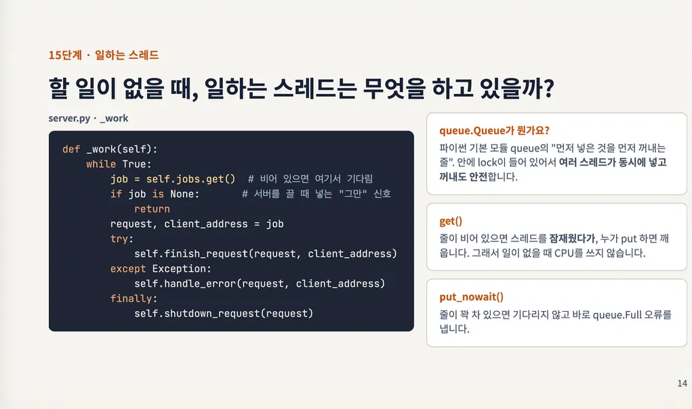
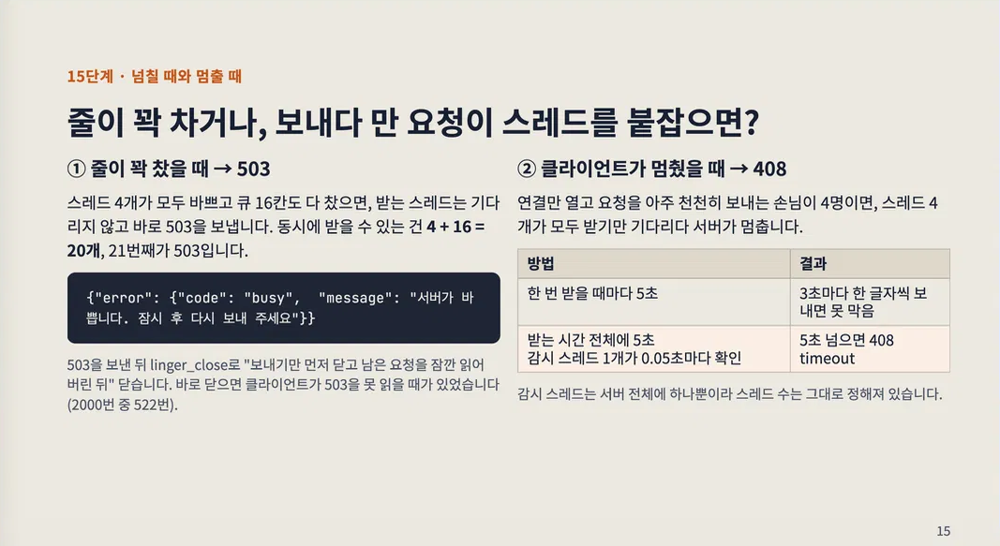
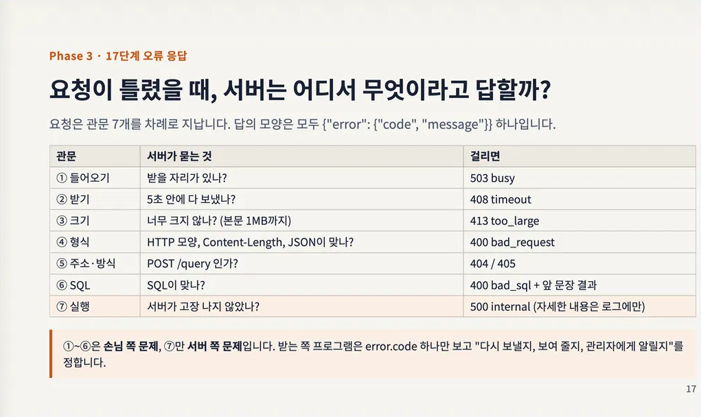

# 미니 DBMS

SQL 문장을 받아서 데이터를 파일에 저장하고, 저장한 데이터 중 원하는 것을 꺼내 주는 작은 데이터베이스(DBMS)를 직접 만드는 과제입니다.

```sql
INSERT INTO users (name, age) VALUES ('현지', 25);   -- 저장: users.tbl 파일에 한 줄 추가 (id는 자동으로 1)
SELECT * FROM users WHERE id = 1;                   -- 꺼내기: 파일에서 id가 1인 줄을 찾아 돌려줌 → 1, 현지, 25
```

### 한눈에: 우리가 푼 문제

SQL 한 줄이 서버에 들어와 파일에 닿기까지, 단계마다 문제 하나씩을 풉니다.

```
요청 ─→ [Phase 3] Thread Pool   스레드 4개가 나눠 받음. 큐까지 차면 503
          ─→ 🔒 lock            엔진에는 한 번에 한 요청만 들어감
             ─→ [Phase 1] SQL 처리기   토큰 → 구문 트리 → 열 이름으로 검사 → 실행
                ─→ [Phase 2] B+ 트리     "id → 파일 위치"로 그 한 줄만 읽음
                   ─→ 파일 (users.tbl)
```

| Phase | 문제 | 해결 | 숫자로 보면 |
| --- | --- | --- | --- |
| 1. SQL 처리기 | 코드가 열을 **순서**로 읽어서, 열이 하나 끼면 엉뚱한 값을 읽음 | SQL로 열 **이름**을 말하고, 처리기가 스키마로 검사해 스키마 순서로 저장. 문법이 틀린 문장이 섞이면 아무것도 실행 안 함 | `(age, name)` 순서로 넣어도 `[id, name, age]`로 저장. 처리기 테스트 223개 통과 |
| 2. B+ 트리 인덱스 | 데이터가 많으면 처음부터 다 읽어서 느림 | INSERT 때 "id → 파일 위치"를 B+ 트리에 적고, 찾을 때 그 한 줄만 읽음 | 100만 건에서 id로 찾기 0.017ms, 다른 열로 찾기(처음부터 읽기) 1,524ms |
| 3. Thread Pool | 서버가 요청을 하나씩만 처리해서, 느린 클라이언트 하나가 전체를 멈춤 | 미리 만든 스레드 4개가 큐(기본 16칸)에서 요청을 꺼내 나눠 처리. 큐까지 차면 바로 503 | 느린 연결 3개가 스레드를 붙잡아도 다른 요청은 약 1ms에 응답 (4개면 약 0.6초 대기) |
| 3. lock | 스레드가 여럿이 되자 동시에 INSERT하면 id가 겹침 | 엔진 입구(`execute`)를 한 번에 한 스레드만 지나가게 함 | 스레드 100개 동시 INSERT: lock 없으면 서로 다른 id 16개, lock 있으면 1\~100 정확 |

세 가지는 맞물립니다. Thread Pool이 요청을 동시에 처리하게 만들고, 그래서 생긴 id 겹침을 lock이 막고, lock 안에 머무는 시간은 처리기와 인덱스가 짧게 해 줍니다.

## 문서

| 순서 | 문서 | 이럴 때 읽기 |
| --- | --- | --- |
| 1 | [왜 DBMS인가](docs/study/WHY_DBMS/WHY_DBMS.md) | DBMS가 어떤 문제를 풀려고 나왔는지, 폴더 하나 예시로 먼저 보고 싶을 때. **처음이면 여기부터** |
| 2 | [전체 그림](docs/study/OVERVIEW.md) | 우리가 만들 DBMS 안에서 SQL 한 줄이 파일에 저장되고 다시 꺼내지기까지를 예시로 보고 싶을 때 |
| 3 | [설계](docs/DESIGN.md) | 단계별로 무엇을 만들고, 언제 완료인지, 어떤 방식을 제안했는지 볼 때 |
| 4 | [학습 노트](docs/study/DBMS_study.md) | 구현하면서 "왜 이렇게 만드나"를 설명할 수 있는지 스스로 확인하고 싶을 때 |
| 5 | [HANDOFF](docs/eungi/HANDOFF.md) | 작은 워킹 샘플(지도 만들기)과 Phase 3를 돌려 보고, 각자 이어서 만들 곳을 볼 때. Phase 1과 합친 기록은 7절 |
| 6 | [결정 기록](docs/eungi/DECISIONS.md) | "왜 이렇게 만들었나"를 결정 번호로 볼 때. 지도 만들기·Phase 3(D1\~D48), Phase 1(H1\~H12), Phase 2(S1\~S7) | 
| 7 | [과제 요구사항](docs/REQUIREMENTS.md) | 과제가 무엇을 요구하는지 원문으로 확인하고 싶을 때 |

과제 원문은 요구사항을 Phase 1·2·3으로 나눕니다.
각 Phase는 DBMS가 처음 풀려고 했던 문제 하나씩과 짝이 됩니다.

| 과제 원문 | 풀어 보는 문제 ([왜 DBMS인가](docs/study/WHY_DBMS/WHY_DBMS.md)) | 왜 그런가 | 연결 | 설계 단계 |
| --- | --- | --- | --- | --- |
| Phase 1. SQL 처리기 | 문제 1. 열(항목 하나, 예: 쿠폰)을 추가하면 다른 코드가 멈춤 | 다른 코드가 "4번째 열이 가격"처럼 **순서**로 읽기 때문에, 열이 하나 끼어들면 순서가 밀려서 엉뚱한 값을 읽거나 멈춤 | 코드가 순서로 읽지 않고, SQL로 열 이름을 말함 (예: `WHERE name = '현지'`). 열 목록은 처리기만 앎. 단, 열을 추가하는 기능(`ALTER TABLE`)은 과제 범위가 아니라 만들지 않음 | 1, 4\~9 |
| Phase 2. B+ 트리 인덱스 | 문제 2. 데이터(행. 예: 주문 100만 건)가 많으면 느림 | 파일 안에는 "id 987654는 몇 바이트째"라는 정보가 없고, 줄마다 길이도 달라서 위치를 계산할 수 없음. 그래서 1번째 줄부터 읽고 비교하기를 줄 수만큼 반복함 → 100건이면 100번, 100만 건이면 100만 번 | `INSERT`할 때 DBMS가 id를 1, 2, 3… 자동으로 붙이고, "id → 파일 위치"를 목차(B+ 트리)에 적어 둠. 찾을 때는 목차를 보고 그 한 줄만 읽음 (예: "id 987654 → 41,203,550바이트째") | 2, 10\~14 |
| Phase 3. API 서버 | 문제 3. 동시에(두 요청이 같은 순간에) 쓰면 망가짐 | `INSERT` 하나는 ① 다음 id 읽기 → ② 파일에 쓰기 → ③ 다음 id 올리기, 세 걸음임. 스레드 두 개가 동시에 돌면 컴퓨터가 번갈아 실행해서, A의 ①과 ③ 사이에 B가 끼어들 수 있음. 그러면 A와 B가 둘 다 id 4를 읽어서 id 4가 두 개 생김 | 서버는 느린 클라이언트 하나가 전체를 멈추지 않도록 요청을 스레드 여러 개로 동시에 처리함 (Thread Pool). 그러자 세 걸음 사이에 끼어들 수 있게 되어, 세 걸음을 lock으로 묶어 한 스레드가 ①\~③을 끝낼 때까지 다른 스레드는 기다리게 함 → 먼저 온 쪽이 id 4, 다음 쪽이 id 5 | 3, 15\~17 |

## 만드는 순서

해야 할 일을 단계별로 더 잘게 나눠봅니다.
지도부터 만들고, 부품을 하나씩 진짜로 바꿉니다. 자세한 단계와 완료 기준은 [설계](docs/DESIGN.md) 3절에 있습니다.

| 단계 | 하는 일 |
| --- | --- |
| 0\~3. 지도 만들기 | 엉성해도 처음부터 끝까지 한 번 돌게 만듦. CLI(터미널에서 SQL 파일을 실행하는 명령) → 파일에 저장(`INSERT`할 때 **id를 1, 2, 3… 자동으로 붙임**) → 임시 인덱스(파이썬 `dict`로 만든 "id → 파일 위치" 목차) → API 서버(다른 프로그램이 HTTP로 SQL을 보낼 수 있는 서버) |
| 4\~9. SQL 처리기 채우기 | 토크나이저(SQL 글자 덩어리를 `INSERT`, `INTO`, `users` 같은 단어로 자름) → 파서(자른 단어를 보고 "users 테이블에 이 값들을 넣어라" 같은 명령 구조로 만듦) → 열 구성 검사(그 테이블과 열이 진짜 있는지, 숫자 열에 숫자가 왔는지 확인) → 저장 형식(파일에 한 줄을 `[1, "현지", 25]`처럼 어떤 모양으로 쓸지 정함) → 껐다 켜기(다시 켜도 데이터가 남고, 다음 id가 이어지게 함) → 오류 처리(잘못된 SQL이 와도 멈추지 않고 무엇이 틀렸는지 알려 줌) |
| 10\~14. B+ 트리 인덱스 | B+ 트리(데이터가 많아도 몇 번만 내려가면 찾는 목차 구조)를 만들어 임시 인덱스와 바꿈 → 100만 건을 넣고 "id로 찾기(목차 사용)"와 "다른 열로 찾기(처음부터 읽기)"의 속도를 비교 |
| 15\~17. 동시 요청 처리 | Thread Pool(요청을 처리할 스레드를 미리 여러 개 만들어 두고 나눠 맡김) → lock(한 번에 한 문장만 실행해서, 두 요청이 같은 id를 받는 일 등을 막음) → API 오류 응답(잘못된 요청에도 정해진 JSON 모양으로 오류를 알려 줌) |
| 18\~19. 마무리 | 테스트 보완(기능, 동시 요청, 엣지 케이스), 문서 정리 |
| 20\~24. 시간이 남으면 | 범위 검색(`WHERE id > 10`), 읽기/쓰기 lock(읽기끼리는 동시에), `EXPLAIN`(인덱스를 썼는지 보여 줌), 미니 레디스 캐시(같은 조회 결과를 저장해 두기), 인덱스 저장(켤 때 목차를 다시 만들지 않기) |

## 실행 및 시연

외부 패키지 설치 없이 **Python 3**만으로 바로 실행할 수 있습니다.

### 1. CLI 실행 (SQL 파일 일괄 처리)
```bash
python3 cli.py examples/step1.sql
```
`data/schema.json` 기준으로 `INSERT`·`SELECT` 문장을 실행하고 결과를 출력합니다.

### 2. API 서버 실행 · 웹 테스트 (`GET /`)
```bash
python3 server.py
```
실행 후 브라우저에서 [`http://localhost:8000`](http://localhost:8000) 에 접속하면 아래 기능을 바로 확인할 수 있습니다.
- `schema.json` 구조 확인 및 `INSERT` · `SELECT` · 오류 JSON(`400` / `404` / `405` / `413`) 테스트
- 현재 `data/users.tbl`에 저장된 데이터 표 실시간 조회  
  *(서버를 `Ctrl + C`로 껐다 켠 뒤 **새로고침**을 눌러도 기존 데이터와 다음 `id`가 유지됩니다.)*

### 3. 동시 접속 · 과부하 방어 확인 (터미널)

**① 동시 6개 요청 — Thread Pool 분산 처리 & `@locked` 동시성 제어**
```bash
for i in 1 2 3 4 5 6; do curl -s -X POST http://localhost:8000/query -d "{\"sql\": \"INSERT INTO users (name, age) VALUES ('u$i', $i);\"}" & done; wait
```
- **응답:** 6건의 `"id"`가 중복 없이 순차적으로 발급됨 (`@locked`)
- **서버 로그:** `[worker-1]` ~ `[worker-4]`가 섞여 출력됨 (`Thread Pool`)

**② 큐 포화 방어(`503 busy`) 재현** *(필요 시)*
```bash
# 터미널 1: 일꾼 1개, 대기 큐 1칸으로 축소 실행
python3 server.py --workers 1 --queue 1
```
```bash
# 터미널 2: 앞 2칸을 점유한 상태에서 3번째 요청 → 즉시 503 busy 응답
(sleep 3 | nc localhost 8000 &) && (sleep 3 | nc localhost 8000 &) && sleep 0.3 && curl -s -X POST http://localhost:8000/query -d '{"sql": "SELECT * FROM users;"}'
```

### 4. Phase 1 SQL 처리기 단독 실행 (`minidb/`)
```bash
python3 -m minidb examples/students.sql      # 처리기만 따로 실행 (표 모양 출력)
pip install -r requirements-dev.txt && pytest  # 처리기 단위 테스트 (pytest 필요)
```
`python3 cli.py`와 `python3 server.py`도 같은 처리기를 엔진(`engine.py`)을 거쳐 씁니다. 파이썬 3.10 이상이 필요합니다.

---

🎮 **시뮬레이터로 눌러 보기**: [`docs/study/threadpool_simulator.html`](docs/study/threadpool_simulator.html)을 내려받아 브라우저로 열고 요청을 보내 보면, 스레드 4개가 큐에서 요청을 꺼내 가고, 엔진 앞(lock)에서 한 명씩 줄을 서고, 스레드와 큐가 모두 차면 503이 나는 모습을 볼 수 있습니다. 느린 손님을 보내면 그 스레드만 붙잡히고 나머지는 계속 일하는 것도 보입니다. 설명용이라 시간은 실제보다 느리게 흐릅니다. (같은 시뮬레이터가 [AI Studio](https://ai.studio/apps/fe913b5f-9510-4adf-95cd-9c66d095757e)에도 있지만, 로그인이 필요할 수 있고 503 표시를 고치기 전 판입니다.)

### 할 일이 없을 때, 일하는 스레드는 무엇을 하고 있나요?



### 왜 Redis처럼 스레드 하나(이벤트 루프)로 하지 않았나요?

| 구분 | 이벤트 루프 (스레드 1개) | 스레드 여러 개 (Thread Pool) |
| --- | --- | --- |
| 잘 맞는 일 | 처리는 아주 짧고 대부분 네트워크를 기다리는 일 (Redis, 채팅 서버) | 처리 하나가 길 수 있는 일 (DB 질의, 파일 읽기) |
| 장점 | 연결이 수만 개여도 스레드 하나라 메모리가 적음. 잠금도 필요 없음 | 처리 하나가 길거나 클라이언트가 느려도, 그 스레드만 붙잡히고 다른 스레드는 계속 일함[^1] |
| 약점 | 처리 하나가 길면 그동안 모든 연결이 멈춤 | 스레드마다 메모리를 쓰고, 운영체제가 번갈아 돌리는 비용이 듦. 잠금이 필요함 |
| 우리 과제 | 실제 Redis처럼 메모리 연산만 짧게 처리할 때 적합 | 우리 mini-dbms에 채택 (느린 클라이언트가 있어도 다른 요청이 안 막히게 스레드 4개 + 큐 16칸, 둘 다 기본값)[^1] |

[^1]: 부하 테스트(`python3 bench/load_test.py B`). 연결만 열고 1초 동안 본문을 안 보내는 느린 손님 K명과 빠른 손님 60명을 섞어 보냄. 느린 손님이 스레드 수보다 적으면 빠른 손님은 약 1ms에 답을 받고, 같거나 많으면 모든 스레드가 붙잡혀 약 0.6초를 기다림. 그래서 스레드 4개는 "느린 연결 3개까지 견딤"이라는 뜻. 단, 전체 스캔 같은 느린 *쿼리*는 lock 안에서 실행되므로 다른 요청도 기다림. 큐 16칸은 측정값이 아니라 판단(짧으면 503이 많고, 길면 오래 기다림).

### 왜 기본 스레드는 4개, 큐는 16칸인가요?


- **스레드는 "기다리는 시간"을 겹치는 도구입니다.** 느린 손님은 스레드 하나를 `recv`에 붙잡아 둡니다. 스레드가 느린 손님보다 많으면 남는 스레드가 빠른 손님을 받고(0.7ms), 같으면 모두 붙잡혀 빠른 손님도 기다립니다(664ms). 그래서 4개 = "느린 연결 3개까지 견딤".
- **그렇다고 많이 늘려도 빨라지지 않습니다.** 빠른 손님만 있으면 기다릴 게 없고, SQL 실행은 lock 안에서 한 번에 하나씩이라 스레드 수와 상관없이 줄을 섭니다(1·4·16개 = 44·70·68ms). 스레드마다 메모리도 쓰니 4개에서 멈췄습니다.
- **큐 16칸은 측정값이 아니라 판단입니다.** 큐가 짧으면 503이 많이 나고, 길면 503은 줄지만 줄에 선 손님이 조금 더 기다립니다(`python3 bench/load_test.py C`). 둘 다 `--workers`, `--queue`로 바꿀 수 있습니다.

### 넘칠 때와 멈출 때



<details>
<summary>글로 보기</summary>

| 상황 | 서버의 답 |
| --- | --- |
| 스레드 4개가 모두 바쁘고 큐 16칸도 다 참 (동시에 붙잡을 수 있는 건 4 + 16 = 20개) | 기다리게 하지 않고 바로 **503 busy** |
| 연결만 열고 요청을 아주 천천히 보냄 | 요청을 받는 시간 **전체**가 5초를 넘으면 **408 timeout** |

"한 번 받을 때마다 5초"로만 막으면 3초마다 한 글자씩 보내는 연결은 끊기지 않아서, 감시 스레드 1개가 0.05초마다 "받는 시간 전체"를 확인합니다. 감시 스레드는 서버 전체에 하나뿐이라 스레드 수는 그대로 정해져 있습니다.

</details>

### 요청이 틀렸을 때 서버는 어디서 무엇이라고 답하나요?



<details>
<summary>글로 보기</summary>

요청은 관문 7개를 차례로 지납니다. 답의 모양은 모두 `{"error": {"code", "message"}}` 하나입니다.

| 관문 | 서버가 묻는 것 | 걸리면 |
| --- | --- | --- |
| ① 들어오기 | 받을 자리가 있나? | 503 `busy` |
| ② 받기 | 5초 안에 다 보냈나? | 408 `timeout` |
| ③ 크기 | 너무 크지 않나? (본문 1MB까지) | 413 `too_large` |
| ④ 형식 | HTTP 모양, Content-Length, JSON이 맞나? | 400 `bad_request` |
| ⑤ 주소·방식 | `POST /query`인가? | 404 / 405 |
| ⑥ SQL | SQL이 맞나? | 400 `bad_sql` + 앞 문장 결과 |
| ⑦ 실행 | 서버가 고장 나지 않았나? | 500 `internal` (자세한 내용은 로그에만) |

①\~⑥은 클라이언트 쪽 문제, ⑦만 서버 쪽 문제입니다. 받는 쪽 프로그램은 `error.code` 하나만 보고 "다시 보낼지, 보여 줄지, 관리자에게 알릴지"를 정합니다.

</details>

## 실제 DBMS와의 차이 (왜 이렇게 만들었나)

| 부분 | 실제 DBMS (MySQL, PostgreSQL) | 우리 mini-dbms | 그렇게 한 이유 |
| --- | --- | --- | --- |
| SQL 처리 | 토큰 → 구문 트리 → 실행 계획을 비교해 가장 빠른 방법 선택 | 토큰 → 파서 → 바로 실행 (Phase 1) | 단일 테이블 조회 위주라 복잡한 옵티마이저 없이 파서 결과를 바로 실행해도 SQL 처리 원리를 구현하기 충분함 |
| 저장 방식 | 8\~16KB 페이지 단위. 자주 쓰는 페이지는 메모리에 캐시(버퍼 풀) | 한 줄씩 JSON으로 파일 끝에 붙임 | 외부 도구 없이 파일을 열어 눈으로 바로 확인할 수 있고, 값에 쉼표나 한글이 들어가도 깨지지 않음 |
| 인덱스 | B+ 트리를 디스크 페이지에 저장. 켤 때 다시 만들지 않음 | B+ 트리가 메모리에만 있음. 켤 때마다 파일을 읽어 다시 만듦 (Phase 2) | 인덱스를 파일에 따로 저장하면 비정상 종료 시 데이터 파일과 어긋날 수 있음. 켤 때 데이터 파일을 기준으로 다시 만들면 항상 일치함 |
| 동시성 | 행 단위 잠금 + 읽는 쪽이 옛 버전을 보는 방식(MVCC). 읽기와 쓰기가 서로 거의 안 막음 | 엔진 전체 잠금 하나 (16단계) | 우리는 이미 있는 행을 고치지 않음(`UPDATE`/`DELETE` 없음). INSERT끼리 다투는 건 행이 아니라 다음 id·파일 끝·인덱스라서, 행 단위로 잠가도 결국 이 셋을 묶는 잠금 하나가 필요함. 잠금이 하나라 교착 상태도 없고 B+ 트리는 동시성을 신경 쓰지 않아도 됨. 대신 느린 쿼리는 다른 요청을 기다리게 함 |
| 트랜잭션·복구 | 여러 문장을 "모두 되거나 모두 안 되게" 묶음. 쓰기 전에 로그를 남겨(WAL) 꺼져도 복구 | 없음. 문장마다 바로 저장. 꺼지면 반쯤 쓴 줄이 남을 수 있음 | 과제 핵심 범위(파서·인덱스·서버)에 집중하기 위해 제외함. 대신 서버에서 부분 실패 시 앞 문장까지의 `results`를 함께 반환해 중복 재시도를 막음 |
| 연결 처리 | 자체 통신 방식 + 스레드 풀이나 프로세스 | HTTP + JSON + 직접 만든 Thread Pool (15단계) | 브라우저·`curl`로 별도 드라이버 없이 테스트할 수 있고, 대기열 상한(기본 16칸, `--queue`로 바꿈)을 직접 제어해 `503` 과부하 방어를 구현·설명할 수 있음 |
| 오류 | 표준 오류 코드(SQLSTATE) | 우리가 정한 JSON 코드 `bad_sql`, `busy` 등 (17단계) | 클라이언트가 `error.code` 하나로 원인을 구분할 수 있고, SQL 문법 실수(400)와 서버 내부 장애(500)를 분리해 내부 경로 노출을 막음 |

"왜 DBMS인가"의 문제 1·2·3을 SQLite로 보여 주는 예전 시연은 [시연 설명](docs/study/WHY_DBMS/why_dbms_demo/README.md)에 그대로 있습니다.
