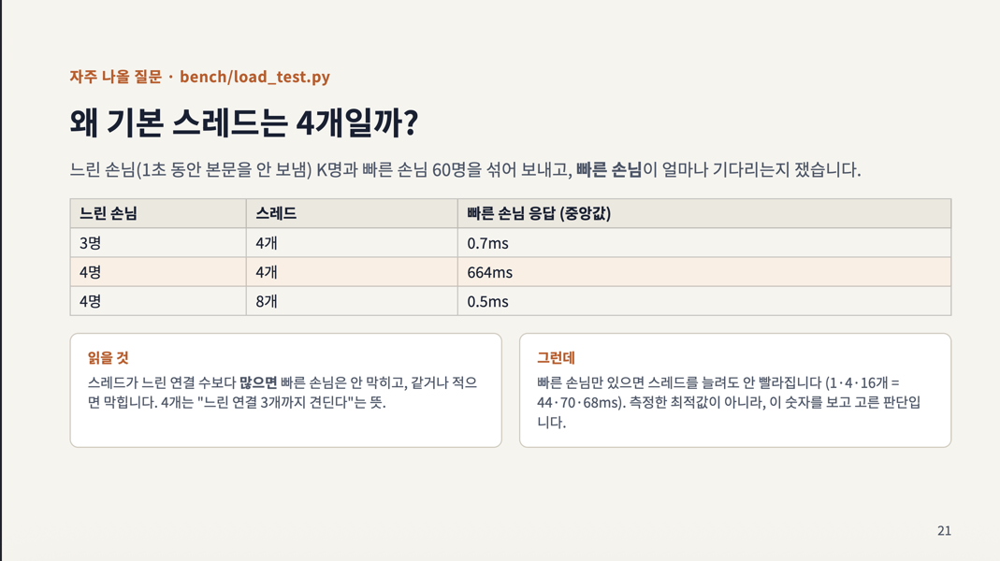

# 미니 DBMS

**SQL 파서부터 B+ 트리 인덱스, Thread Pool API 서버까지, 외부 라이브러리 없이 처음부터 만든 데이터베이스.**

```
HTTP → Thread Pool → 🔒 lock → SQL 처리기 → B+ 트리 → 파일
```

- **모든 단계의 바닥, SQL 처리기** → 공백으로 자르는 대신 토크나이저 → 구문 트리 → 실행기 → 저장소로 경계를 나눔. 덕분에 B+ 트리와 서버를 붙일 때 처리기 코드는 `errors.py` 한 줄만 바뀜.
- **느린 연결 하나가 서버를 멈추는 문제** → 워커 4개 + 대기열 16칸을 직접 구현, 넘치면 즉시 503. 느린 연결 3개가 붙어도 다른 요청은 약 1ms.
- **동시 INSERT의 id 중복** → 행 잠금 대신 엔진 lock 하나. 경합 지점이 행이 아니라 `next_id`·파일 끝·인덱스였기 때문. 100스레드 동시 INSERT에서 id 1~100 연속.
- **lock 때문에 생긴 대기 줄** → `id → 파일 위치` B+ 트리로 전체 스캔 대신 그 한 줄만 읽어 lock 안 시간을 줄임.

> Thread Pool이 동시성을 만들고, lock이 그 경합을 막고, B+ 트리가 lock 구간을 짧게 만든다. **세 결정이 하나의 문제를 이어서 푼다.**

```sql
INSERT INTO users (name, age) VALUES ('현지', 25);   -- users.tbl 끝에 한 줄 추가, id는 자동으로 1
SELECT * FROM users WHERE id = 1;                   -- B+ 트리로 위치를 찾아 그 한 줄만 읽음 → 1, 현지, 25
```

## 목차

1. [바로 돌려 보기](#바로-돌려-보기)
2. [어떻게 만들었나](#어떻게-만들었나)
3. [실제 DBMS와 다른 점](#실제-dbms와-다른-점)
4. [남은 과제](#남은-과제)
5. [문서](#문서)

## 바로 돌려 보기

Python 3.10 이상만 있으면 됩니다. 실행에 필요한 외부 패키지는 없습니다.

```bash
python3 server.py
```

브라우저에서 [`http://localhost:8000`](http://localhost:8000)을 열면 스키마를 보고, `INSERT`·`SELECT`와 오류 응답(`400`·`404`·`405`·`413`)을 바로 보내 볼 수 있습니다. 서버를 껐다 켜도 데이터와 다음 `id`가 그대로 남습니다.

```bash
curl -s -X POST http://localhost:8000/query -d '{"sql": "SELECT * FROM users WHERE id = 1;"}'
```

<details>
<summary>동시 요청 · 503 · CLI · 처리기 단독 실행 · 테스트</summary>

**동시 요청 6개: Thread Pool과 lock**
```bash
for i in 1 2 3 4 5 6; do curl -s -X POST http://localhost:8000/query -d "{\"sql\": \"INSERT INTO users (name, age) VALUES ('u$i', $i);\"}" & done; wait
```
응답의 `id`는 겹치지 않고, 서버 로그에는 `[worker-1]`~`[worker-4]`가 섞여 나옵니다.

**대기열이 차면 503**
```bash
python3 server.py --workers 1 --queue 1          # 터미널 1: 워커 1개, 대기열 1칸
(sleep 3 | nc localhost 8000 &) && (sleep 3 | nc localhost 8000 &) && sleep 0.3 && \
curl -s -X POST http://localhost:8000/query -d '{"sql": "SELECT * FROM users;"}'   # 터미널 2: 세 번째 요청 → 503 busy
```

**lock이 왜 필요한지**
```bash
python3 checks/check_concurrency.py              # lock 끔 → id 중복, lock 켬 → 1~100
```

**CLI와 처리기 단독 실행**
```bash
python3 cli.py examples/step1.sql                # 엔진(lock, B+ 트리)을 거쳐 실행
python3 -m minidb examples/students.sql          # SQL 처리기만 따로 실행 (표 모양 출력)
```

**테스트**
```bash
pip install -r requirements-dev.txt && pytest    # 처리기 단위 테스트 223개
python3 checks/check_all.py                      # 기능 확인
```

</details>

🎮 [`docs/study/threadpool_simulator.html`](docs/study/threadpool_simulator.html)을 내려받아 브라우저로 열면, 스레드 4개가 대기열에서 요청을 꺼내 가고, lock 앞에서 한 명씩 줄을 서고, 다 차면 503이 나는 모습을 눌러 볼 수 있습니다.

## 어떻게 만들었나

### SQL 처리기

**왜 공백으로 자르면 안 되나요?**
`VALUES ('Kim Lee', 3)`는 이름 안의 공백에서 잘리고, `grade=3;`은 붙어 있어 떨어지지 않고, `'a;b'` 안의 `;`는 문장 끝으로 오해합니다. `--` 주석과 `'it''s'` 같은 따옴표 규칙도 모릅니다. 그래서 글자를 하나씩 읽는 토크나이저를 만들고, 토큰마다 줄과 칸을 기억해 `3:12: FROM 이 와야 하는데…`처럼 오류 위치를 알려 줍니다.

**왜 토큰을 그대로 실행하지 않나요?**
그러면 실행기가 "`FROM` 뒤는 테이블 이름, 쉼표는 건너뛰기, 괄호 짝 확인" 같은 문법 지식까지 떠안습니다. 문법을 바꾸면 실행이 깨지고, 실행을 바꾸면 문법이 깨집니다. 그래서 파서가 재귀 하강으로 구문 트리를 만들고, 실행기는 `stmt.where.column`처럼 이름으로만 꺼냅니다. 테이블과 열이 있는지, 타입이 맞는지는 스키마를 아는 실행기가 검사합니다.

**왜 전부 해석한 뒤 실행하나요?**
3번째 문장에 오타가 있는데 앞의 두 INSERT가 먼저 저장되면, 오타를 고쳐 다시 보낼 때 두 행이 또 저장됩니다. 그래서 하나라도 문법이 틀리면 아무것도 실행하지 않습니다. 실행 중 오류(없는 열 등)는 미리 알 수 없으므로, 그 문장에서 멈추고 이미 저장된 앞 문장 결과를 함께 돌려줍니다.

**파일에는 어떻게 쓰나요?**
쉼표로 나누면 `'Kim, Lee'`가 두 값으로 읽힙니다. 그래서 한 줄에 한 행, 값은 탭으로 나누고, 탭·줄바꿈·백슬래시는 이스케이프합니다. 쓸 때마다 그 줄의 **바이트 위치를 돌려주게** 해 둔 덕에, B+ 트리가 이 위치를 그대로 받아 씁니다. 쓰다가 꺼져서 마지막 줄이 반쪽이면, 다음에 열 때 잘라 내서 새 행이 반쪽 행에 이어 붙지 않게 합니다.

### 왜 실제 Redis처럼 스레드 하나(이벤트 루프)로 하지 않았나요?

| 구분 | 이벤트 루프 (스레드 1개) | 스레드 여러 개 (Thread Pool) |
| --- | --- | --- |
| 잘 맞는 일 | 처리는 아주 짧고 대부분 네트워크를 기다리는 일 (실제 Redis, 채팅 서버) | 처리 하나가 길 수 있는 일 (DB 질의, 파일 읽기) |
| 장점 | 연결이 수만 개여도 스레드 하나라 메모리가 적음. 잠금도 필요 없음 | 클라이언트가 느려도 그 스레드만 붙잡히고, 다른 스레드는 계속 일함[^1] |
| 약점 | 처리 하나가 길면 그동안 모든 연결이 멈춤 | 스레드마다 메모리를 쓰고, 운영체제가 번갈아 돌리는 비용이 듦. 잠금이 필요함 |
| 우리 과제 | 메모리 연산만 짧게 처리할 때 적합 | 미니 DBMS에 채택. 스레드 4개 + 대기열 16칸 (둘 다 기본값)[^1] |

[mini-redis](https://github.com/team1-mini-lab/mini-redis)는 실제 Redis와 달리 Flask가 요청마다 스레드를 만들고, 저장소에 lock 하나를 둡니다. 미니 DBMS와 같은 방식입니다. 다른 점은 스레드 수입니다. DB 처리는 캐시보다 오래 걸려서, 끝없이 받으면 쌓이기만 하므로 수와 대기열에 상한을 두었습니다.

파이썬의 `ThreadPoolExecutor`는 내부 대기열에 끝이 없습니다. 요청 1000개를 한꺼번에 보내니 964개가 쌓이고 386개가 시간 초과로 실패했습니다. 직접 만든 Pool은 16칸이 차는 순간 나머지에 503을 보내 1.9초 만에 끝났습니다 ([D34](docs/eungi/DECISIONS.md#step15)).

[^1]: `python3 bench/load_test.py B`. 연결만 열고 1초 동안 본문을 보내지 않는 느린 연결 K개와 빠른 요청 60개를 섞어 보냄. 느린 연결이 스레드 수보다 적으면 빠른 요청은 약 1ms에 답을 받고, 같거나 많으면 모든 스레드가 붙잡혀 약 0.6초를 기다림. 단, 전체 스캔 같은 느린 *쿼리*는 lock 안에서 실행되므로 다른 요청도 기다림.

### 왜 기본 스레드는 4개, 대기열은 16칸인가요?



- 느린 연결은 스레드 하나를 붙잡습니다. 스레드가 느린 연결보다 **많으면** 남는 스레드가 다른 요청을 받고(0.7ms), **같으면** 모두 붙잡혀 다들 기다립니다(664ms). 그래서 4개 = "느린 연결 3개까지 견딤".
- 더 늘려도 빨라지지 않습니다. SQL 실행은 lock 안에서 한 번에 하나씩이라, 빠른 요청만 있을 때 스레드 1·4·16개가 44·70·68ms로 거의 같았습니다.
- 대기열은 짧으면 503이 많고, 길면 오래 기다립니다. 재 보니 4칸과 16칸은 거의 같았고(503 22·23건, 평균 대기 33.4·32.9ms), 16칸은 그 사이에서 고른 기본값입니다 ([D35](docs/eungi/DECISIONS.md#step15)).

연결만 열고 보내지 않는 클라이언트는 5초 뒤 `408`로 끊어서, 스레드를 오래 붙잡지 못하게 했습니다. 스레드 수와 대기열 칸 수는 `--workers`, `--queue`로 바꿀 수 있습니다.

### 왜 행 단위가 아니라 lock 하나인가요?

INSERT 하나는 "다음 id 읽기 → 파일 끝에 쓰기 → 다음 id 올리기 → 인덱스에 적기"입니다. 스레드 둘이 동시에 돌면 그 사이에 끼어들어 같은 id를 받습니다. 실제 DBMS는 바꾸는 행만 잠그지만, 우리는 `UPDATE`/`DELETE`가 없어 기존 행을 고치지 않습니다. 다투는 곳은 행이 아니라 `next_id`·파일 끝·인덱스이고, B+ 트리는 동시에 쓰면 안전하지 않습니다. 그래서 엔진 입구(`execute`)에 **lock 하나**를 걸었습니다. 잠금이 하나라 서로 기다리다 멈추는 일(교착 상태)도 없습니다.

lock을 빼면 빨라질 것 같지만, 재 보니 오히려 4~8배 느려졌습니다. 파일을 한 줄씩 읽을 때마다 스레드들이 GIL을 주고받는 비용이 커지기 때문입니다 ([STEP16](docs/eungi/STEP16.md)). 처음부터 다 읽는 SELECT를 빠르게 하는 방법은 lock을 푸는 게 아니라 인덱스입니다.

### 왜 해시 테이블이 아니라 B+ 트리인가요?

mini-redis의 해시 테이블은 키 하나를 찾는 데는 가장 빠르지만 순서를 모릅니다. B+ 트리는 id 순서를 유지하고 맨 아래 노드끼리 이어져 있어서, 같은 구조로 범위 검색(`id > 100`)까지 넓힐 수 있습니다.

- **트리에는 행이 아니라 파일 위치만 담습니다.** 100만 줄을 메모리에 다시 두지 않습니다. 파일이 원본이고 트리는 목차입니다 ([S1](docs/eungi/DECISIONS.md#phase2)).
- **노드 하나에 키 256개.** 100만 건에서 8~8192를 재 보고 가장 빠른 구간(128~512)에서 골랐습니다 ([S2](docs/eungi/DECISIONS.md#phase2)).
- **켤 때마다 데이터 파일로 다시 만듭니다.** 인덱스를 따로 저장하면 비정상 종료 때 데이터 파일과 어긋날 수 있어서, 데이터 파일을 기준으로 다시 만들어 항상 일치시킵니다.

100만 건 성능 비교는 [BPTREE](docs/somang/BPTREE.md)에 있습니다.

### 요청이 틀렸을 때 서버는 어디서 무엇이라고 답하나요?


<details>
<summary>글로 보기</summary>

요청은 관문 7개를 차례로 지납니다. 답의 모양은 모두 `{"error": {"code", "message"}}` 하나입니다.

| 관문 | 서버가 묻는 것 | 걸리면 |
| --- | --- | --- |
| ① 들어오기 | 받을 자리가 있나? | 503 `busy` |
| ② 받기 | 5초 안에 다 보냈나? | 408 `timeout` |
| ③ 크기 | 너무 크지 않나? (본문 1MB까지) | 413 `too_large` |
| ④ 형식 | HTTP 모양, Content-Length, JSON이 맞나? | 400 `bad_request` |
| ⑤ 주소·방식 | `POST /query`인가? | 404 / 405 |
| ⑥ SQL | SQL이 맞나? | 400 `bad_sql` + 앞 문장 결과 |
| ⑦ 실행 | 서버가 고장 나지 않았나? (파일 손상 포함) | 500 `internal` (자세한 내용은 로그에만) |

①\~⑥은 클라이언트 쪽 문제, ⑦만 서버 쪽 문제입니다. 받는 쪽 프로그램은 `error.code` 하나만 보고 "다시 보낼지, 보여 줄지, 관리자에게 알릴지"를 정합니다.

</details>

## 실제 DBMS와 다른 점

| 부분 | 실제 DBMS (MySQL, PostgreSQL) | 미니 DBMS | 그렇게 한 이유 |
| --- | --- | --- | --- |
| SQL 처리 | 토큰 → 구문 트리 → 실행 계획을 비교해 가장 빠른 방법 선택 | 토큰 → 구문 트리 → 바로 실행. `id = ?`면 인덱스, 아니면 전체 스캔 | 테이블 하나를 조회하는 문장이라, 옵티마이저 없이도 SQL 처리 원리를 구현하기에 충분함 |
| 저장 방식 | 8\~16KB 페이지 단위. 자주 쓰는 페이지는 메모리에 캐시(버퍼 풀) | 한 줄에 한 행, 탭으로 구분해 파일 끝에 붙임 | 파일을 눈으로 바로 확인할 수 있고, 값에 쉼표나 한글이 들어가도 깨지지 않음 |
| 인덱스 | B+ 트리를 디스크 페이지에 저장. 켤 때 다시 만들지 않음 | B+ 트리가 메모리에만 있음. 켤 때마다 파일을 읽어 다시 만듦 | 데이터 파일을 기준으로 다시 만들면 비정상 종료 뒤에도 항상 일치함 |
| 동시성 | 행 단위 잠금 + 읽는 쪽이 옛 버전을 보는 방식(MVCC) | 엔진 lock 하나 | 기존 행을 고치지 않아 경합 지점이 `next_id`·파일 끝·인덱스뿐. 교착 상태가 없음. 대신 느린 쿼리는 다른 요청을 기다리게 함 |
| 트랜잭션·복구 | 여러 문장을 "모두 되거나 모두 안 되게" 묶음. 쓰기 전에 로그를 남겨(WAL) 꺼져도 복구 | 없음. 문장마다 바로 저장. 쓰다 만 마지막 줄만 켤 때 잘라 냄 | 과제 핵심(파서·인덱스·서버)에 집중. 대신 실행 중 오류면 앞 문장까지의 결과를 돌려줘 중복 재시도를 막음 |
| 연결 처리 | 자체 통신 방식 + 스레드 풀이나 프로세스 | HTTP + JSON + 직접 만든 Thread Pool | 브라우저·`curl`로 별도 드라이버 없이 테스트할 수 있고, 대기열 상한으로 503 과부하 방어를 직접 제어함 |
| 오류 | 표준 오류 코드(SQLSTATE) | 정해 둔 JSON 코드 `bad_sql`, `busy` 등 | `error.code` 하나로 원인을 구분하고, SQL 실수(400)와 서버 장애(500)를 나눠 내부 경로가 밖으로 나가지 않게 함 |

## 남은 과제

| 남은 것 | 왜 남았나 |
| --- | --- |
| 범위 검색 (`WHERE id > 100`) | B+ 트리에 `range_search`는 있지만 아직 SQL과 연결하지 않음 |
| B+ 트리 기록·조회를 실행기 안으로 | 통합 때 처리기 코드를 건드리지 않으려고 엔진에서 붙임. 처리기 설계(실행기 안)와 맞추는 중 |
| 인덱스 파일 저장 | 지금은 켤 때마다 100만 건을 다시 읽음 |
| 읽기끼리는 동시에 | lock 하나라 SELECT끼리도 기다림 |
| 서버와 CLI가 같은 폴더에 동시에 쓰기 | 프로세스 사이 잠금이 없음 |

## 문서

| 문서 | 이럴 때 읽기 |
| --- | --- |
| [왜 DBMS인가](docs/study/WHY_DBMS/WHY_DBMS.md) | DBMS가 어떤 문제를 풀려고 나왔는지 폴더 하나 예시로 보고 싶을 때. **처음이면 여기부터** |
| [전체 그림](docs/study/OVERVIEW.md) | SQL 한 줄이 파일에 저장되고 다시 꺼내지기까지를 코드로 따라가고 싶을 때 |
| [설계](docs/DESIGN.md) | 단계별로 무엇을 만들고, 언제 완료인지 볼 때 |
| [Phase 1 단계 문서](docs/hnjee/) | 토크나이저부터 엣지 케이스까지, SQL 처리기의 단계별 설계와 결정 |
| [B+ 트리](docs/somang/BPTREE.md) | B+ 트리 구조와 100만 건 성능 비교 |
| [Phase 3 단계 문서](docs/eungi/) | Thread Pool(STEP15), lock(STEP16), 오류 응답(STEP17) |
| [결정 기록](docs/eungi/DECISIONS.md) | "왜 이렇게 만들었나"를 결정 번호로. Phase 1(H1\~H12), Phase 2(S1\~S7), Phase 3(D1\~D48) |
| [학습 노트](docs/study/DBMS_study.md) | "왜 이렇게 만드나"를 설명할 수 있는지 스스로 확인할 때 |
| [HANDOFF](docs/eungi/HANDOFF.md) | 작은 워킹 샘플과 Phase 3를 돌려 보고, 이어서 만들 곳을 볼 때 |
| [과제 요구사항](docs/REQUIREMENTS.md) | 과제 원문 |
