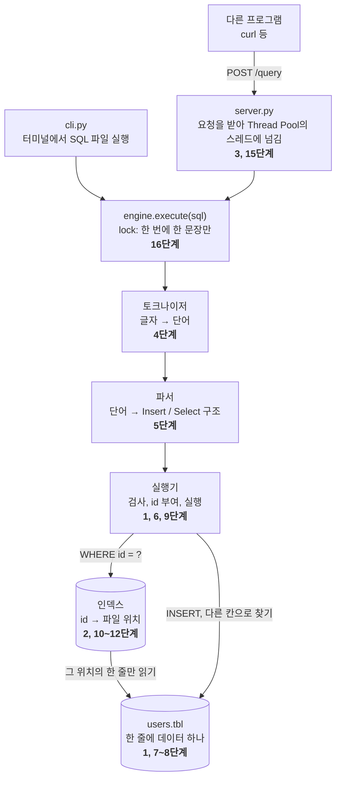

# 미니 DBMS 설계 문서
개념 설명은 [OVERVIEW.md](./study/OVERVIEW.md)에 있습니다.

이 문서에는 **큰 줄기만** 적습니다. 오류 코드, 검사 순서 같은 세부 규칙은 그 단계에 도착했을 때 정하고 4번 결정 기록에 더합니다.

## 1. 요구사항

과제 가이드에서 뽑은 요구사항입니다. 각 요구사항은 3번의 개발 단계와 연결되어 있어, 개발 단계를 모두 마치면 요구사항이 모두 충족됩니다.

| 번호 | 요구사항 | 충족되는 단계 |
| --- | --- | --- |
| R1 | 텍스트 파일에 적은 SQL을 CLI 명령으로 처리기에 전달해 실행 | 1 |
| R2 | SQL 문장을 분석해 구조화 (파싱) | 1, 4, 5 |
| R3 | `INSERT`: 데이터를 파일에 저장 | 1, 7 |
| R4 | `SELECT`: 파일에서 데이터를 읽어 출력 | 1, 7 |
| R5 | 테이블마다 파일 하나로 관리, 저장 형식 설계 | 7 |
| R6 | 레코드가 추가되면 ID 자동 부여 | 1, 8 |
| R7 | 자동 부여된 ID를 메모리 기반 B+ 트리에 인덱스로 등록 | 10, 11, 12 |
| R8 | `WHERE id = ?` 검색 시 B+ 트리 사용 | 2, 12 |
| R9 | 100만 건 이상 레코드를 만들어 삽입 | 13 |
| R10 | ID 검색(인덱스)과 다른 칸 검색(선형 탐색)의 속도 비교 | 14 |
| R11 | 외부 클라이언트가 API로 DBMS 기능 사용 | 3 |
| R12 | Thread Pool을 구성해 요청을 병렬로 처리 | 15 |
| R13 | 멀티 스레드 환경에서 동시성 문제가 생기지 않는 구조 | 16, 18 |
| R14 | SQL 처리기와 B+ 트리 인덱스를 그대로 서버의 내부 엔진으로 사용 | 3, 12 |
| R15 | 단위 테스트로 각 함수 검증 | 5, 7, 10, 11, 18 |
| R16 | 기능 테스트 (SQL 처리, 인덱스 적용, API 동작) | 1, 14, 18 |
| R17 | 엣지 케이스 고려 | 6, 9, 17, 18 |
| R18 | 핵심 로직(파서, B+ 트리, Thread Pool, lock)을 설명할 수 있음 | 19 |
| R19 | (선택) 다른 팀과의 차별화 요소 | 20~24 |

하지 않을 것: `CREATE TABLE` (테이블 모양은 미리 파일로 준비), `UPDATE`, `DELETE`, `JOIN`, 트랜잭션, 디스크 기반 B+ 트리, 사용자 인증.

## 2. 구조

### 전체 흐름

CLI와 API 서버는 같은 `execute(sql)`을 부릅니다. 그래서 서버를 붙일 때 엔진 코드를 고치지 않습니다.

### 접점 1: 엔진

| 함수 | 받는 것 | 돌려주는 것 |
| --- | --- | --- |
| `Engine(data_dir)` | 데이터 폴더 | 엔진. 만들 때 파일을 읽어 다음 ID와 인덱스를 준비함 |
| `execute(sql)` | SQL 문자열 (여러 문장이면 `;`로 구분) | 문장마다 결과 하나씩 담은 리스트 |
| `close()` | 없음 | 없음. 파일을 닫음 |

| 문장 | 결과 하나의 모양 |
| --- | --- |
| `INSERT` | `{"type": "insert", "id": 부여된 ID}` |
| `SELECT` | `{"type": "select", "columns": [...], "rows": [[...], ...], "used_index": true/false}` |
| 실패한 문장 | `{"type": "error", "message": "..."}` |

### 접점 2: 파서가 만드는 구조

| 문장 | 구조 |
| --- | --- |
| `INSERT INTO users (name, age) VALUES ('현지', 25);` | `Insert(table="users", columns=["name", "age"], values=["현지", 25])` |
| `SELECT name FROM users WHERE id = 3;` | `Select(table="users", columns=["name"], where=Where("id", "=", 3))` |
| `SELECT * FROM users;` | `Select(table="users", columns=["*"], where=None)` |

### 접점 3: 인덱스 함수

| 함수 | 받는 것 | 돌려주는 것 |
| --- | --- | --- |
| `insert(key, value)` | ID, 파일 위치 | 없음 |
| `search(key)` | ID | 파일 위치. 없으면 `None` |

2단계의 임시 `dict`와 12단계의 B+ 트리가 같은 두 함수를 가지므로, 바꿔 끼워도 엔진은 그대로입니다.

### 접점 4: API

| 동작 | 요청 | 성공 응답 | 실패 응답 |
| --- | --- | --- | --- |
| SQL 실행 | `POST /query` 본문 `{"sql": "SELECT * FROM users WHERE id = 1;"}` | 200 `{"results": [...]}` | 400 (잘못된 요청이나 SQL), 503 (서버가 바쁨) |

세부 동작은 4번 결정 기록에 단계별로 정리되어 있습니다. 테이블 파일의 모양은 [OVERVIEW.md](./study/OVERVIEW.md) 2절에 있습니다.

## 3. 개발 순서

**지도부터 만들고, 칸을 한 겹씩 채웁니다.**

지도 만들기는 엉성해도 CLI → 엔진 → 파일 → 인덱스 → API까지 **처음부터 끝까지 한 번 돌아가는** 가장 작은 버전을 먼저 만드는 것입니다. 지도가 있으면 전체 모양이 처음부터 보이고, 이후 단계는 지도의 한 칸을 진짜 부품으로 바꾸는 일이 됩니다. 매 단계의 결과는 CLI와 API로 확인합니다.

### 지도 만들기

| 단계 | 만드는 것 | 이것이 보이면 완료 | 요구사항 |
| --- | --- | --- | --- |
| 0. 준비 | 프로젝트 폴더, `schema.json`, 예제 SQL 파일 | 폴더 구조와 예제 파일이 있음 | |
| 1. CLI 뼈대 | SQL 파일 읽기 → 임시 파서(공백·쉼표로 나누는 수준) → `INSERT`는 파일에 한 줄 추가, `SELECT *`는 전체 출력. ID 자동 부여 | `INSERT` 두 번 후 `SELECT * FROM users;`를 하면 ID 1, 2가 붙은 줄이 나옴 | R1, R2, R3, R4, R6, R16 |
| 2. 임시 인덱스 | 파이썬 `dict`(ID → 파일 위치)로 `WHERE id = ?` 처리 | `WHERE id = 2`에 그 줄 하나만 나오고, 인덱스를 썼다고 표시됨 | R8 |
| 3. API 뼈대 | `POST /query` 서버 (아직 스레드 하나). CLI와 같은 `execute(sql)`을 부름 | curl로 보낸 SQL의 결과가 CLI와 같음 | R11, R14 |

여기까지가 지도입니다. 과제 전체의 흐름이 한 번 돌아갑니다.

### SQL 처리기 채우기 (과제의 Phase 1)

| 단계 | 바꾸는 것 | 이것이 보이면 완료 | 요구사항 |
| --- | --- | --- | --- |
| 4. 토크나이저 | 임시 나누기 → SQL을 단어(토큰)로 자르는 토크나이저 | 글자 값 안에 공백·쉼표·`;`가 있어도 정확히 나뉨 | R2 |
| 5. 파서 | 임시 파서 → 재귀 하강 파서 | 접점 2의 예시가 그대로 나오고, 문법이 틀린 문장은 오류 | R2, R15 |
| 6. 테이블 모양 검사 | 실행기가 `schema.json`과 비교 | 없는 테이블·칸, 칸 수나 타입이 틀린 `INSERT`가 오류 | R17 |
| 7. 저장 형식 | 한 줄에 JSON 배열 하나, 파일 위치로 한 줄만 읽기 | 한글이나 쉼표가 든 값도 깨지지 않음 | R3, R4, R5, R15 |
| 8. 껐다 켜기 | 시작할 때 파일을 읽어 다음 ID와 인덱스를 다시 만듦 | 껐다 켜도 데이터가 남고, 다음 ID가 이어짐 | R6 |
| 9. 오류 처리 | 실패한 문장을 결과에 담음. CLI는 다음 문장을 계속 실행 | 잘못된 문장이 섞인 파일에서 나머지는 실행되고, 무엇이 틀렸는지 보임 | R17 |

### B+ 트리 인덱스 (과제의 Phase 2)

| 단계 | 바꾸는 것 | 이것이 보이면 완료 | 요구사항 |
| --- | --- | --- | --- |
| 10. B+ 트리 찾기 | 노드 모양과 찾기 (엔진과 따로) | 손으로 만든 작은 트리에서 키를 찾음 | R7, R15 |
| 11. B+ 트리 넣기 | 넣기와 노드 나누기 | 키 1만 개를 무작위 순서로 넣어도 모두 찾고, 트리 높이가 출력됨 | R7, R15 |
| 12. 인덱스 교체 | 임시 `dict` → B+ 트리 | 2단계와 결과가 같고, 인덱스 종류만 바뀜 | R7, R8, R14 |
| 13. 100만 건 만들기 | `INSERT` 100만 줄짜리 SQL 파일을 만드는 스크립트 | 만든 파일을 CLI로 실행하면 100만 건이 들어감 | R9 |
| 14. 성능 비교 | ID로 찾기와 다른 칸으로 찾기의 시간 측정 | 1만, 10만, 100만 건에서의 비교가 표로 정리됨 | R10, R16 |

### 동시 요청 처리 (과제의 Phase 3)

| 단계 | 바꾸는 것 | 이것이 보이면 완료 | 요구사항 |
| --- | --- | --- | --- |
| 15. Thread Pool | 스레드 하나 서버 → 작업 큐 + 미리 만든 스레드 N개 | 동시에 보낸 요청이 여러 스레드 이름으로 처리된 로그가 보임 | R12 |
| 16. lock | 엔진 실행을 lock으로 감싸기 | 동시에 `INSERT`를 100번 보내도 ID가 1~100으로 빠짐없이, 겹치지 않음 | R13 |
| 17. API 오류 응답 | 잘못된 요청에 JSON 오류로 답함 | 없는 주소, JSON이 아닌 본문 등에 HTML이 아니라 JSON 오류가 옴 | R17 |

### 마무리

| 단계 | 만드는 것 | 이것이 보이면 완료 | 요구사항 |
| --- | --- | --- | --- |
| 18. 테스트 보완 | 기능 테스트, 동시 요청 테스트, 엣지 케이스 테스트 | 전체 테스트가 통과함 | R13, R15, R16, R17 |
| 19. 문서 정리 | README (실행 방법, 구조, 파서·B+ 트리·Thread Pool 설명), 결정 기록, 성능 결과 | 처음 보는 사람이 README만으로 실행하고 구조를 이해할 수 있음 | R18 |

### 시간이 남으면 (우선순위 순)

| 단계 | 만드는 것 | 이것이 보이면 완료 | 요구사항 |
| --- | --- | --- | --- |
| 20. 범위 검색 | `WHERE id > ?`, `BETWEEN`을 B+ 트리의 맨 아래 칸 연결로 처리 | 범위 조회도 인덱스를 씀 | R19 |
| 21. 읽기/쓰기 lock | 읽기끼리는 동시에, 쓰기는 혼자 | 읽기가 많을 때 처리량이 늘어난 숫자 | R19 |
| 22. `EXPLAIN` | 인덱스를 썼는지, 몇 줄 읽었는지 출력 | `EXPLAIN SELECT ...`에 계획이 나옴 | R19 |
| 23. 쿼리 캐시 | 미니 레디스에 `SELECT` 결과를 저장, `INSERT` 때 지움 | 같은 조회 두 번째부터 빨라지고, 넣은 뒤엔 새 값이 보임 | R19 |
| 24. 인덱스 저장 | 인덱스를 파일로 저장해 켤 때 다시 만들지 않음 | 100만 건에서 켜는 시간 비교 숫자 | R19 |

진행 상황은 GitHub 이슈로 관리합니다. 단계 번호는 이슈와 결정 기록에서 참조하므로 바꾸지 않습니다. 단계를 추가할 때는 "3-1"처럼 붙입니다.

## 4. 결정 참고사항

큰 줄기만 적었습니다. 세부 규칙은 그 단계에 도착했을 때 정하고 여기에 더합니다.

| 단계 | 결정 | 이유 | 상태 |
| --- | --- | --- | --- |
| 전체 | 사용 언어는 파이썬 | 팀 전체가 익숙하고 미니 레디스와 같은 언어 | 제안 |
| 전체 | 지도(0~3단계)를 먼저 만들고 칸을 바꿔 끼우는 순서로 개발 | 부품끼리 맞물리는 문제를 처음에 발견하고, 언제든 시연할 수 있음 | 제안 |
| 전체 | 표준 라이브러리만 사용 (테스트 도구 제외) | 파서, B+ 트리, Thread Pool을 직접 만들어 설명할 수 있어야 함 | 제안 |
| 전체 | CLI와 API는 같은 `execute(sql)`을 부름 | 서버를 붙일 때 엔진을 그대로 씀 | 제안 |
| 0 | 테이블 모양은 `schema.json`에 미리 적어 둠. 타입은 `INT`, `TEXT` 두 가지 | `CREATE TABLE`이 없으므로 칸과 타입을 알 곳이 필요 | 제안 |
| 0 | 모든 테이블의 첫 칸은 `id INT` | 자동 ID와 인덱스의 기준 | 제안 |
| 1 | 지도 만들기 단계에서는 정확성보다 끝까지 도는 것이 우선. 임시 파서는 예제 SQL만 처리하면 됨 | 엉성한 부분은 4~9단계에서 바꿔 끼움 | 제안 |
| 1 | 다음 ID는 "지금까지 가장 큰 ID + 1", 1부터 시작 | 단순하고, 껐다 켜도 파일에서 다시 알 수 있음 | 제안 |
| 2 | 임시 인덱스는 `dict`이고, B+ 트리와 같은 `insert`/`search` 함수로 감쌈 | 12단계에서 클래스만 바꾸면 되도록 | 제안 |
| 2 | `WHERE id = ?`일 때만 인덱스, 나머지는 처음부터 읽기 | 과제의 비교 조건과 같음 | 제안 |
| 3 | HTTP 서버는 표준 `http.server`. 주소는 `POST /query` 하나 | SQL 자체에 동작이 담겨 있어 주소를 나눌 필요가 없음 | 제안 |
| 4 | 문장 구분(`;`)은 토큰으로 자른 뒤에 함 | 글자 값 안의 `;`를 문장 끝으로 착각하지 않게 | 제안 |
| 5 | 파서는 재귀 하강 방식. 지원 문법은 `INSERT INTO t [(칸들)] VALUES (값들)`, `SELECT */칸들 FROM t [WHERE 칸 = 값]` | 구현과 설명이 쉽고, 최소 요구사항에 집중 | 제안 |
| 6 | 테이블·칸이 있는지, 타입이 맞는지는 실행기가 `schema.json`으로 검사 | 파서는 문법만, 실행기는 뜻을 봄 | 제안 |
| 6 | `INSERT`에 `id`를 직접 넣으면 오류 | 자동 ID와 겹치는 문제를 처음부터 막음 | 제안 |
| 7 | 저장 형식은 한 줄에 JSON 배열 하나 (JSON Lines), 파일 끝에 추가만 함 | 쉼표·한글이 든 값도 안전하고, 이미 쓴 줄의 위치가 안 바뀌어 인덱스가 계속 맞음 | 제안 |
| 8 | 인덱스는 메모리에만 두고, 켤 때 테이블 파일을 한 번 읽어 다시 만듦 | 과제가 메모리 기반을 요구. 파일이 원본이라 둘이 어긋나지 않음 | 제안 |
| 9 | 문장 오류는 예외로 던지지 않고 결과에 담음. CLI는 계속, API는 첫 오류에서 멈춤 | 100만 건 중 한 줄 때문에 전부 멈추지 않게 함 | 제안 |
| 11 | B+ 트리에는 데이터가 아니라 파일 위치를 담음. 노드 크기(차수)는 각자 실험해 기록 | 메모리를 아끼고, 차수에 따른 높이와 속도 차이가 발표 재료 | 제안 |
| 13 | 100만 건은 SQL 파일로 만들고, CLI(SQL 처리기)로 넣음 | "SQL 처리기를 그대로 사용" 요구 | 제안 |
| 14 | 무작위 ID 여러 개로 재고, 1만·10만·100만 건으로 늘려 가며 비교 | 숫자 하나보다 "늘어나는 모양"이 차이를 잘 보여 줌 | 제안 |
| 15 | Thread Pool은 `queue.Queue` + 미리 만든 스레드 N개. 큐가 가득 차면 503 | 원리가 그대로 보이고, 요청이 끝없이 쌓이는 것을 막음 | 제안 |
| 16 | 엔진 전체에 lock 하나, lock은 엔진 안에서 처리 (미니 레디스와 같은 방식) | 단순하고 확실함. CLI든 서버든 lock을 빠뜨릴 수 없음. 개선은 21단계 | 제안 |
| 17 | 오류 응답은 `{"error": {"code": "...", "message": "..."}}` 한 가지 모양 | 주소마다 모양이 다르면 받는 쪽이 따로따로 처리해야 함 | 제안 |
