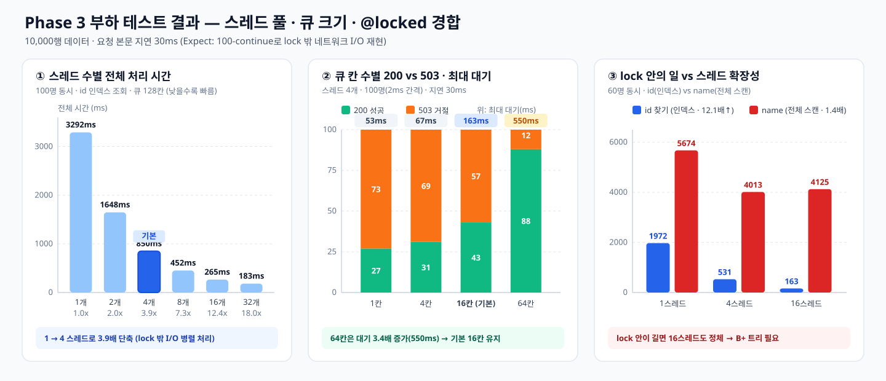

# Phase 3(17단계): API 오류 응답과 서버 방어

> **한 줄 요약**: 404·405·400·408·413·500·503 모든 오류를 `{"error": {"code", "message"}}` 한 모양으로 통일하고, 느린 요청·큰 본문·큐 가득 찬 상태 종료·옵션 오류를 막았으며, 부하 테스트(`bench/load_test.py`)로 스레드·큐·lock의 동작을 수치로 검증했습니다.

Phase 3의 세 단계(16 lock → 15 Thread Pool → 17 오류 응답) 중 마지막 단계입니다. 앞선 단계는 [STEP16](./STEP16.md), [STEP15](./STEP15.md)에 있습니다.

## 왜 필요한가

15단계까지는 잘못된 주소(`/nope`), POST가 아닌 요청(`GET /query`), 느린 본문·헤더 전송, 1MB를 넘는 본문, 예상 못 한 서버 오류에 대해 HTML이 나가거나 응답 없이 연결이 끊겼습니다.

클라이언트가 오류마다 따로 처리하지 않도록 **모든 오류 응답을 JSON 한 모양(`D38`)**으로 맞추고, 악성·비정상 요청에도 서버가 버티게 만듭니다.

## 오류 코드 표 ([D38](./DECISIONS.md#step17))

| 상태 번호 | `code` | 언제 나오나 |
| --- | --- | --- |
| 400 | `bad_request` | `Content-Length` 누락/음수/숫자 아님, 본문이 짧음, JSON이 아님, `sql` 키 없음/문자열 아님 |
| 400 | `bad_sql` | 문법 오류, 없는 테이블/열, 타입 불일치 (`results`에 그 전까지 실행된 결과 포함) |
| 404 | `not_found` | `/query` 외의 주소로 요청 (`POST /nope`) |
| 405 | `method_not_allowed` | `POST`가 아닌 방식 (`GET`, `PUT`, `DELETE` 등) |
| 408 | `timeout` | `request_timeout`(기본 5초) 안에 요청 줄·헤더·본문을 다 받지 못함 |
| 413 | `too_large` | `Content-Length`가 `MAX_BODY`(1MB)를 넘음 |
| 500 | `internal` | 예상 못 한 서버 내부 예외 (상세 로그는 서버에만 남기고 응답에는 `"서버 내부 오류"`만, [D39](./DECISIONS.md#step17)) |
| 503 | `busy` | 일하는 스레드와 큐가 모두 가득 참 |

## 핵심 코드

위치는 줄 번호 대신 **파일과 함수 이름**으로 적었습니다. 아래 코드는 실제 `server.py`와 같습니다.

### ① 모든 오류 한 모양 · [`server.py`](../../server.py)의 `error_body`, `Handler._error`

```python
def error_body(code, message, **extra):
    return {"error": {"code": code, "message": message}, **extra}
```

- 일반 오류는 `{"error": {"code": ..., "message": ...}}`만, `bad_sql`처럼 이미 실행된 결과가 있을 때만 `extra`로 `"results": done`을 덧붙입니다.
- `BaseHTTPRequestHandler` 내부에서 나는 HTTP 문법 오류도 `send_error`를 재정의해 같은 JSON 모양으로 보냅니다.

### ② 405와 404 · [`server.py`](../../server.py)의 `handle_one_request`, `_handle_post`

- `self.command != "POST"`이면 바로 `405 method_not_allowed`를 보냅니다 (`HEAD` 요청이면 헤더만 보내고 본문은 쓰지 않음).
- `self.path != "/query"`이면 `404 not_found`를 보냅니다.

### ③ 1MB 제한(413)과 본문 검증(400) · [`server.py`](../../server.py)의 `_handle_post` ([D42](./DECISIONS.md#step17))

- `Content-Length`가 없거나 음수/숫자가 아니면 `400 bad_request`.
- `length > MAX_BODY`(`1048576`)이면 본문을 읽지 않고 곧바로 `413 too_large`를 보낸 뒤 `linger_close`로 닫습니다.
- 읽은 바이트 수(`len(raw)`)가 `length`보다 짧으면 `400 bad_request` (`"본문이 Content-Length보다 짧습니다"`).

### ④ 500 내부 오류 숨김 · [`server.py`](../../server.py)의 `_handle_post` ([D39](./DECISIONS.md#step17))

```python
        try:
            results = self.server.engine.execute(sql, stop_on_error=True)
        except Exception:
            traceback.print_exc()
            self._error(500, "internal", "서버 내부 오류")
            return
```

- 예상 못 한 예외가 나면 서버 터미널에만 스택 트레이스를 남기고, 외부 응답에는 내부 파일 경로나 구조를 노출하지 않습니다.

### ⑤ 요청을 받는 시간 전체에 5초 · 감시 스레드 ([D37](./DECISIONS.md#step15))

- 소켓 `timeout`만 걸면 0.3초마다 1바이트씩 천천히 보내는 연결을 막지 못합니다.
- `PooledHTTPServer`의 감시 스레드(`_watch_loop`)가 요청 읽기 시작부터 `request_timeout`초를 재다가 초과하면 `sock.shutdown(socket.SHUT_RD)`로 읽기만 깨웁니다.
- 쓰기 반쪽은 열려 있어서 워커 스레드가 깨어나자마자 요청 줄·헤더·본문 어느 단계에서든 `408 timeout` JSON 응답을 안전하게 보낼 수 있습니다.

### ⑥ 답을 클라이언트가 읽을 수 있게 닫기 · `linger_close` ([D43](./DECISIONS.md#step17))

```python
def linger_close(sock, timeout=0.2):
    """답을 먼저 보낸 뒤 클라이언트가 읽을 틈을 주고 닫는다 (큰 본문 도중 503/413 시 RST 방지)."""
    try:
        sock.shutdown(socket.SHUT_WR)
    except OSError:
        return
    try:
        sock.settimeout(timeout)
        end = time.monotonic() + timeout
        while time.monotonic() < end:
            data = sock.recv(65536)
            if not data:
                break
    except OSError:
        pass
```

- 200KB처럼 큰 본문을 보내던 중 큐가 꽉 차 `503`이나 `413`을 보내고 바로 `close()`하면, 커널의 수신 버퍼에 읽지 않은 바이트가 남아 있어 TCP `RST` 패킷이 날아가고 클라이언트가 `503`을 못 읽을 수 있습니다.
- `linger_close`가 `sock.shutdown(socket.SHUT_WR)`로 먼저 쓰기 종료를 알린 뒤, 최대 0.2초 동안 클라이언트가 `503`/`413`을 읽고 연결을 닫을 틈을 준 다음 소켓을 닫습니다.

### ⑦ 큐가 꽉 찬 채 끄기 & 실행 옵션 검사 · `server_close`, `parse_arguments` ([D44](./DECISIONS.md#step17), [D45](./DECISIONS.md#step17))

- `server_close()`에서 감시 스레드를 멈추고 읽기 중인 소켓을 `SHUT_RD`로 깨운 뒤 큐에 남은 연결을 정리하고 `None`을 넣으므로, 큐가 꽉 찬 상태에서도 1초 안에 종료됩니다.
- `--workers`, `--queue`에 `0`이나 음수를 넘기면 시작 전에 `1 이상이어야 합니다` 오류로 막고, `--port`는 `1~65535`만 허용합니다. 포트가 이미 사용 중일 때도 스택 트레이스 대신 친절한 메시지를 출력하고 종료합니다.

### ⑧ 클라이언트가 먼저 끊으면 조용히 · `PooledHTTPServer._work` ([D46](./DECISIONS.md#step17))

```python
            try:
                self.finish_request(request, client_address)
            except (BrokenPipeError, ConnectionResetError):
                pass
            except Exception:
                self.handle_error(request, client_address)
```

## 부하 테스트 · [`bench/load_test.py`](../../bench/load_test.py) ([D35](./DECISIONS.md#step15) 근거)



1만 건 데이터에서 네트워크 지연(30ms, lock 밖 I/O)을 `Expect: 100-continue`로 재현해 측정한 결과입니다.

| 실험 | 핵심 수치 | 알 수 있는 것 |
| --- | --- | --- |
| ① 스레드 수 (손님 100명 동시, `id` 찾기) | `1개` 3292ms → `4개` 850ms → `16개` 265ms → `32개` 183ms | lock 밖 I/O가 있으면 스레드를 늘릴수록 거의 비례해서 빨라짐 (1→4개 약 3.9배) |
| ② 큐 칸 수 (스레드 4개, 손님 100명, 2ms 간격) | `1칸`: 200 27 / 503 73 (최대 53ms) · `16칸`: 200 43 / 503 57 (최대 163ms) · `64칸`: 200 88 / 503 12 (최대 550ms) | 큐가 너무 작으면(1~4) 70% 안팎 즉시 거절되고, 너무 크면(64) 대기 시간이 3.4배로 늘어남 → 기본 `16칸` 유지 |
| ③ lock 안의 일 (손님 60명, `id` vs `name`) | `id`(인덱스): 1972ms → 163ms (**12.1배**) / `name`(전체 스캔): 5674ms → 4125ms (**1.4배**) | lock 안이 길어지면 스레드를 16개로 늘려도 전부 lock 앞에서 줄을 섬 → Phase 2 B+ 트리와 Phase 3 Thread Pool이 함께 필요 |

## 직접 확인해 보기

```bash
python3 checks/check_errors.py      # 16/16 통과
python3 checks/check_threadpool.py  # 6/6 통과
python3 checks/check_concurrency.py # 통과
python3 checks/check_all.py         # 지금 통과해야 하는 것: 11/11
python3 bench/load_test.py          # 부하 테스트 수치 재측정
```

## 이 단계에서 정한 것

자세한 이유는 [결정 기록의 Phase 3(17단계) 절](./DECISIONS.md#step17)에 있습니다.

- **D35 (보완)** 기본 스레드 4개·큐 16칸 유지를 부하 테스트 수치로 뒷받침했습니다.
- **D37 (보완)** 요청 하나당 5초 제한을 소켓 한 번 받기에서 **요청 읽기 전체 시간(감시 스레드)**으로 바꿨습니다.
- **D38** 모든 API 오류를 `{"error": {"code", "message"}}` 한 모양으로 통일합니다 (`400`, `404`, `405`, `408`, `413`, `500`, `503`).
- **D39** `500 internal`일 때 자세한 예외는 서버 로그에만 남기고 응답에는 `"서버 내부 오류"`만 보냅니다.
- **D42** 요청 본문 최대 크기(`MAX_BODY`)는 1MB이며, 초과 시 본문을 읽지 않고 `413 too_large`를 보냅니다.
- **D43** `503`·`413` 응답 뒤 `linger_close`로 최대 0.2초 기다렸다 닫아 큰 본문 중 TCP `RST`를 막습니다.
- **D44** `server_close()`에서 감시 중인 소켓을 `SHUT_RD`로 깨우고 큐를 비워 큐가 꽉 찬 채로도 1초 안에 종료합니다.
- **D45** `--workers`/`--queue`(1 이상), `--port`(1~65535)를 시작 전에 검사하고 포트 충돌 시 친절한 메시지를 남깁니다.
- **D46** 클라이언트가 응답 전에 끊어도(`BrokenPipeError`, `ConnectionResetError`) 서버 터미널에 오류 스택을 쌓지 않습니다.

## 만든 파일

| 파일 | 내용 |
| --- | --- |
| `server.py` (고침) | 오류 JSON 통일, `MAX_BODY` 1MB, 감시 스레드 전체 시간 timeout, `linger_close`, `server_close` 정리, 실행 옵션 검사 |
| `checks/check_errors.py` (새로) | 404/405/400/413/500/408(빈 연결·느린 본문·느린 헤더)/503(200KB×30)/큐 꽉 찬 종료/실행 옵션 16개 확인 |
| `bench/load_test.py` (새로) | 스레드 수·큐 크기·lock 경합 부하 테스트 및 `bench/results.json` 저장 |
| `docs/eungi/STEP17.md` (새로) | 17단계 작업 기록 |
| `docs/eungi/phase3_load_test.svg` · `.png` (새로) | 부하 테스트 발표용 그래프 |

## 다른 담당에게 영향

| 담당 | 영향 |
| --- | --- |
| Phase 1, 2 | 없음. `engine.execute` 호출 규약은 그대로입니다 |
| 클라이언트 / 발표 시연 | 모든 오류를 `body["error"]["code"]`와 `body["error"]["message"]` 한 규칙으로 처리할 수 있습니다 |
