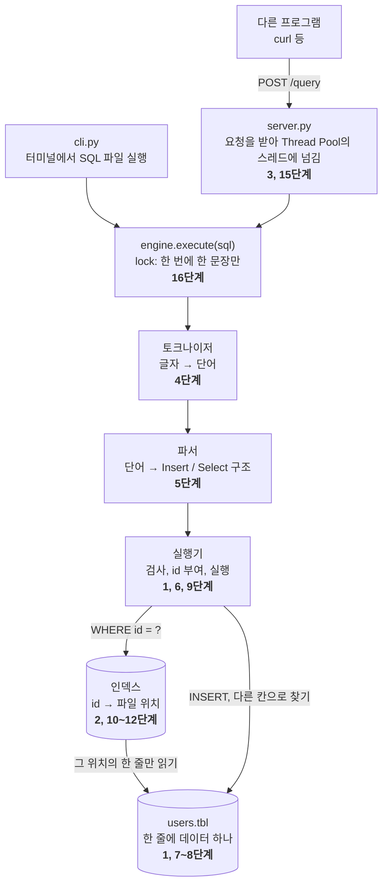

# 미니 DBMS 전체 그림

미니 DBMS가 SQL 한 줄을 어떻게 처리하는지 코드로 따라가는 문서입니다. 왜 DBMS가 필요한지는 [왜 DBMS인가](./WHY_DBMS/WHY_DBMS.md), 무엇을 어떤 순서로 만드는지는 [설계](../DESIGN.md)에 있습니다.

> 예시는 [설계](../DESIGN.md)에 **제안**으로 적힌 방식대로 만들었을 때의 모습입니다. 고를 수 있는 것은 4절에 모았습니다.

## 1. 한눈에 보기



굵은 글씨의 숫자는 [설계](../DESIGN.md)의 개발 단계입니다.

## 2. SQL 한 줄이 처리되는 과정

테이블에 어떤 칸이 있는지는 `schema.json`에 미리 적어 둡니다.

```json
{ "users": [["id", "INT"], ["name", "TEXT"], ["age", "INT"]] }
```

### INSERT: 파일에 한 줄 쓰기

```sql
INSERT INTO users (name, age) VALUES ('현지', 25);
```

```
1. 토크나이저: 글자를 단어로 자름
   INSERT | INTO | users | ( | name | , | age | ) | VALUES | ( | '현지' | , | 25 | ) | ;

2. 파서: 단어를 구조로 만듦
   Insert(table="users", columns=["name", "age"], values=["현지", 25])

3. 실행기:
   - schema.json과 비교 (users 테이블이 있나, age가 숫자인가)
   - id를 붙임 (다음 id = 1)
   - 파일 끝에 한 줄 추가          → users.tbl의 0바이트 위치에 [1, "현지", 25]
   - 인덱스에 위치를 적음          → 1 → 0바이트
```

세 명을 넣으면 이렇게 됩니다.

```
users.tbl                         인덱스
   0바이트  [1, "현지", 25]          1 → 0
  18바이트  [2, "민수", 31]          2 → 18
  36바이트  [3, "지영", 28]          3 → 36
```

파일 끝에 **덧붙이기만** 하므로, 이미 쓴 줄의 위치는 바뀌지 않습니다. 그래서 인덱스에 적은 위치가 계속 맞습니다.

### SELECT: id로 찾기 vs 다른 칸으로 찾기

```sql
SELECT * FROM users WHERE id = 3;        -- 인덱스를 씀
SELECT * FROM users WHERE name = '지영';  -- 처음부터 읽음
```

실행기 안에서는 이렇게 갈립니다.

```python
if where.column == "id":
    offset = index.search(3)          # 인덱스에서 위치를 찾음 → 36
    row = storage.read_at("users", offset)   # 그 줄 하나만 읽음
else:
    for offset, row in storage.scan("users"):   # 첫 줄부터
        if row[1] == "지영": ...                  # name 칸을 하나씩 비교 (끝까지)
```

| 데이터 수 | id로 찾기 | name으로 찾기 |
| --- | --- | --- |
| 3건 | 1줄 읽음 | 3줄 읽음 |
| 100만 건 | 1줄 읽음 | 100만 줄 읽음 |

이 차이를 숫자로 재는 것이 성능 비교(14단계)입니다.

### 인덱스: B+ 트리

처음에는 인덱스를 파이썬 `dict`로 만들고(2단계), 나중에 B+ 트리로 바꿉니다(10~12단계). 둘 다 `insert(id, 위치)`와 `search(id)`만 있으면 되므로, 바꿔도 실행기 코드는 그대로입니다.

노드 하나에 키를 3개까지 담는 B+ 트리에 1~6을 넣으면 이렇게 자랍니다.

```
1, 2, 3 넣기:   [1 2 3]

4 넣기 → 넘침:      [3]                 ← 반으로 나누고 오른쪽 첫 키를 위로
                  /     \
              [1 2] ↔ [3 4]

6까지 넣기:      [3 | 5]
               /   |   \
          [1 2] ↔ [3 4] ↔ [5 6]        ← 맨 아래 칸에만 위치가 있고, 서로 이어져 있음
```

미니 레디스의 해시 테이블은 `id = 5`처럼 딱 맞는 값은 더 빨리 찾지만, 순서가 없어서 `id`가 2~5인 것을 찾으려면 전부 확인해야 합니다. B+ 트리는 순서대로 정리돼 있어서 2가 있는 칸만 찾고 옆으로 이어 읽으면 됩니다.

### 껐다 켜기

인덱스는 메모리에만 있어서 끄면 사라집니다. 켤 때 파일을 한 번 읽어 다시 만듭니다(8단계).

```python
for offset, row in storage.scan("users"):
    index.insert(row[0], offset)      # row[0]이 id. id → 위치
next_id = 가장 큰 id + 1
```

### 다른 프로그램에서 쓰기: API 서버

```python
# cli.py
engine = Engine("data/")
print(engine.execute(open("queries.sql").read()))

# server.py
engine = Engine("data/")

def handle(request):                  # POST /query 가 오면
    sql = request.json["sql"]
    result = engine.execute(sql)      # cli.py와 같은 함수
    return json_response(result)
```

CLI와 서버가 **같은** `engine.execute(sql)`을 부르므로, 서버를 붙여도 엔진 코드는 고치지 않습니다. 과제 요구사항의 "내부 DB 엔진과 외부 API 서버 사이의 연결"이 이 한 줄입니다.

### 동시에 요청이 올 때

서버는 스레드 여러 개로 요청을 동시에 받습니다(Thread Pool, 15단계). lock이 없으면 이런 일이 생깁니다.

```
스레드 A: next_id를 읽음 → 4
스레드 B: next_id를 읽음 → 4        ← A가 5로 바꾸기 전에 읽음
스레드 A: id=4로 저장, next_id = 5
스레드 B: id=4로 저장, next_id = 5
→ id 4가 두 개. 인덱스에서 하나가 덮어써져 사라짐
```

그래서 엔진 안에 lock을 하나 둡니다(16단계).

```python
class Engine:
    def execute(self, sql):
        with self._lock:              # 한 번에 한 스레드만 들어옴
            return self._execute(sql)
```

lock을 서버가 아니라 엔진 안에 두므로, CLI든 서버든 빠뜨릴 수 없습니다. 미니 레디스에서 저장소 안에 lock을 둔 것과 같은 방식입니다.

## 3. 미니 레디스와 다른 점

| | 미니 레디스 | 미니 DBMS |
| --- | --- | --- |
| 맡은 일 | 자주 쓰는 결과의 사본을 잠시 보관 | 원본을 계속 보관 |
| 저장하는 곳 | 메모리 (끄면 사라짐) | 파일 (끄면 남음. 인덱스만 다시 만듦) |
| 찾는 방법 | 키 하나로 | SQL로 여러 조건 |
| 핵심 자료구조 | 해시 테이블 | B+ 트리 |
| 요청 주소 | 동작마다 따로 (`/set`, `/get`, `/delete`) | SQL에 동작이 담겨 있어서 하나 (`/query`) |
| 동시 요청 | Flask가 스레드를 만들어 줌 | Thread Pool을 직접 만듦 |

## 4. 팀이 정할 것 (아직 제안)

| 항목 | 고를 수 있는 것 | 추천 |
| --- | --- | --- |
| 저장 형식 | CSV `1,현지,25` / JSON 배열 `[1, "현지", 25]` / 한 줄 길이가 정해진 이진 형식 | JSON 배열. CSV는 이름에 쉼표가 있으면 칸이 늘어나 깨짐 (`1,김,철수,25`) |
| B+ 트리에 담는 것 | 데이터 전체 / 파일 위치 | 파일 위치 (메모리를 아끼고, 원본은 파일 하나) |
| B+ 트리 노드 하나에 넣는 키 수 | 적게 / 많이 | 바꿔 가며 높이와 속도를 재서 비교. 100만 건이면 4개일 때 약 9층, 100개일 때 약 3층 |
| `INSERT`에 `id`를 직접 넣으면 (`INSERT INTO users (id, name) VALUES (5, '민수')`) | 오류 / 무시 / 허용 | 오류. 허용하면 나중에 자동 id가 5가 될 때 id 5가 두 개 생김 |
| 동시성 | lock 하나 / 읽기·쓰기를 나눈 lock | lock 하나로 시작 |
| Thread Pool | 직접 만들기 / 파이썬 `ThreadPoolExecutor` | 직접 만들기 (과제의 핵심이라 원리를 설명할 수 있게) |
| 범위 검색 (`WHERE id > ?`) | 만들기 / 안 만들기 | 시간이 남으면 가장 먼저 (B+ 트리를 고른 이유를 보여 줌) |
